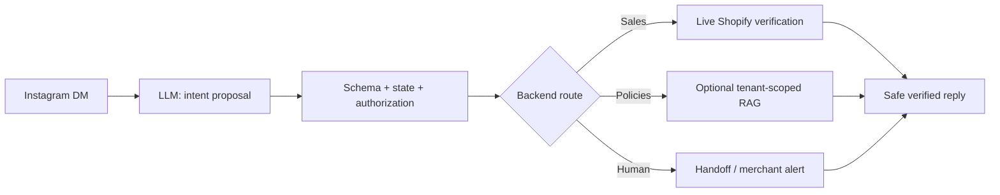

# Generative AI × Chatout — visual learning handbook

**Learn the idea → see the diagram → apply to a real sales-agent failure → design a safe experiment.**

> **Truth in labeling:** This is a study notebook based on our CampusX LangChain/RAG and Agentic AI discussions through **26 Nov 2026**. **Studied concepts are not deployed features.** All new AI work is proposed for an isolated lab unless approved through the Chatout product workflow.

## Start here: five-minute visual overview

**Remember:** LLM understands *what the customer may mean*; backend determines *what is allowed and true*. A fluent answer is not proof of inventory, payment or checkout success.

## Choose your reading path

| You have... | Start with | Then |
|---|---|---|
| **5 minutes** | [Visual atlas](visual-atlas.md) | [Why each class matters](video-to-project-map.md) |
| **30 minutes** | [Models](langchain/02-components-and-models.md) → [Prompts](langchain/03-prompts-and-messages.md) → [Schema](langchain/04-structured-outputs.md) | [Checkout regression](chatout/failure-cases.md) |
| **A study session** | Follow LangChain lessons 01–11 below | Try [lab thought experiments](chatout/lab-experiments.md) |
| **An architecture review** | [Trust boundaries](chatout/architecture-and-safety.md) | [Multi-turn + RAG diagrams](visual-atlas.md) |
| **Interview prep** | [Q&A](chatout/interview-preparation.md) | Explain diagrams in your own words |

## Course notes — lessons already discussed

| Track | Lesson | Practical outcome | Learning evidence |
|---|---|---|---|
| LangChain | [01 · LLM introduction](langchain/01-introduction-llms.md) | Understand language vs facts | Discussed |
| LangChain | [02 · Components and models](langchain/02-components-and-models.md) | Separate chat and embedding roles | Discussed |
| LangChain | [03 · Prompts and messages](langchain/03-prompts-and-messages.md) | Recover conversational context safely | Discussed |
| LangChain | [04 · Structured outputs](langchain/04-structured-outputs.md) | Typed intent proposals | Discussed |
| LangChain | [05 · Output parsers](langchain/05-output-parsers.md) | Reject malformed proposals | Discussed |
| LangChain | [06 · Runnables and chains](langchain/06-runnables-and-chains.md) | Sequence / parallel / branch | Discussed |
| LangChain | [07 · Document loaders](langchain/07-document-loaders.md) | Trace source and metadata | Discussed |
| LangChain | [08 · Text splitters](langchain/08-text-splitters.md) | Keep policy clauses together | Discussed |
| LangChain | [09 · Embeddings / vector stores](langchain/09-embeddings-and-vector-stores.md) | Semantic retrieval foundations | Discussed |
| LangChain | [10 · Retrievers](langchain/10-retrievers.md) | Search approved current evidence | Discussed |
| LangChain | [11 · RAG](langchain/11-rag.md) | Ground FAQ answers; no fine-tuning needed | Discussed; RAG quiz B |
| Agentic AI | [What is Agentic AI?](agentic-ai/01-what-is-agentic-ai.md) | Bounded, stateful tool choices | Video 2 quiz B, 1/1; lab pending |

**Next lesson:** LangChain vs LangGraph. It is **not yet completed**; only high-level previews appear in the documents. Class numbers in this repo are a **topic-learning sequence**, not a precise official video-index claim.

## Deep dives

- **[Visual atlas](visual-atlas.md):** nine GitHub-rendered flow / sequence diagrams for the complete journey.
- **[Quick revision sheet](quick-revision.md):** all 12 concepts on one page, with a five-minute self-check.
- **[Video-to-project map](video-to-project-map.md):** one matrix connecting each class to concrete Chatout decisions.
- **[Architecture and safety](chatout/architecture-and-safety.md):** model vs backend vs retrieval authority.
- **[Actual failure cases](chatout/failure-cases.md):** turn-4 checkout continuity and checkout + human takeover.
- **[Lab evaluation plan](chatout/lab-experiments.md):** focused synthetic fixtures and hard acceptance checks.
- **[Interview answers](chatout/interview-preparation.md):** explain decisions, not just vocabulary.
- **[Learning progress](learning-progress.md):** distinguish theory, labs, merge and runtime acceptance.

## Five safety rules worth memorizing

1. **Model output is a proposal**, not an authorization to call a transaction API.
2. **Tenant identity comes from the backend**, never from user prompts or retrieved document text.
3. **Shopify or the trusted commerce backend owns** current price, stock, checkout and order claims.
4. **RAG is evidence retrieval**, not an inventory, checkout, or permission engine.
5. **Learning lab ≠ product implementation**. Master Excel tracker remains the only product source of truth; no auto-promotion to the running AI-service.

## How to use these notes actively

After each class, write a three-sentence recap, trace one diagram aloud, answer the **checkpoint**, then write one negative test that would catch a real Chatout regression. Record lab results only after running them. Avoid adding unsafely detailed customer messages, credentials, live tokens, internal endpoint addresses or merchant PII to this public repo.

**Legend for diagrams:** solid arrows = flow/dependency; dotted arrows = optional conceptual linkage; decision diamonds = explicit policy/validation choices. Diagrams are intentionally simplified, **not production topology snapshots**.

---

**Source:** Our class-by-class CampusX learning discussions. Wording, diagrams and code examples are independently authored educational explanations, not copied video transcripts.
