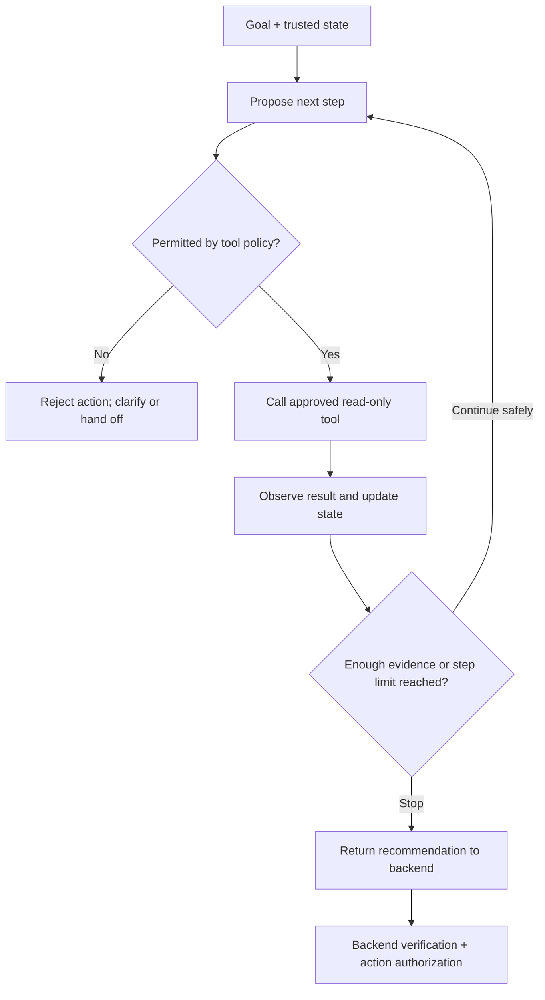

# Agentic AI — 01: What is Agentic AI?

**Learning status:** CampusX *Agentic AI using LangGraph*, Video 2 ("What is Agentic AI?") discussed; knowledge-check answer **B** was correct (**1/1**). **Practical lab not completed.** Next topic **LangChain vs LangGraph** is still pending confirmation.

## Concept in Hinglish

**Normal LLM call:** input diya, response mila. **Fixed chain:** predefined steps follow hoti hain. **Agentic AI:** system goal ke basis par bounded choices karta hai — reasoning/planning, tools, intermediate observations, state and possible retries — but **only within developer-approved limits**. Being "agentic" does not automatically make a system reliable, and not every task benefits from autonomy.

| Pattern | Example | When to prefer |
|---|---|---|
| Simple model invocation | FAQ wording / intent suggestion | One bounded transformation |
| Fixed sequential/conditional chain | Validate intent → trusted lookup → respond | Deterministic sales workflow |
| Stateful graph | Clarify missing SKU, preserve selection and resume | Multi-turn branching with recovery |
| Agent with tool selection | Choose among approved read-only knowledge tools | When dynamic choice is truly needed |

## Chatout mapping

Customer sequence:

```text
T1: I want ski wax.
T2: Which one is available?
T3: Two pieces.
T4: Great, send the checkout link.
```

A stateful workflow should track `workspace_id`, `conversation_id`, `verified_product_id`, `quantity`, `handoff_requested`, `checkout_readiness`, `tool_results` and action status. The **model may suggest next action**; the backend validates and decides whether that action is authorized.

### Decision boundary

- **Agent may propose:** `lookup_product`, `ask_clarification`, `retrieve_policy`, `request_handoff`.
- **Agent must not independently:** invent prices, declare stock, charge cards, create/claim a checkout without backend verification, send live Instagram messages without required gates.
- **A graph doesn't fix bugs by itself:** missing selection recovery and mixed handoff must be addressed in state design and tests.

## Lab experiment: bounded checkout state machine

Build a tiny fake graph with states `NEED_PRODUCT → VERIFY_PRODUCT → READY_FOR_CHECKOUT / HANDOFF / CLARIFY`. Use mock merchant API responses and no external sends.

## Acceptance checks

1. Turn-4 checkout without product text recovers **trusted** earlier selection.
2. "checkout link bhejo **ya seller se baat karwa do**" preserves handoff information, with appropriate priority.
3. Invalid product/stock returns clarification; no fabricated URL.
4. Retry/replay never duplicates a side-effect (idempotency key and event log).
5. Workspace A's state/data cannot be used to answer workspace B.

## Implementation decision

**Learn and prototype stateful orchestration in an isolated lab only.** Do not replace current Chatout AI-service merely because LangGraph can model a state machine. Require measured improvement against the real regression suite and explicit approval before integration.

**Interview answer:** "An agent uses tools and maintains state to pursue a goal, but in production its autonomy must be scoped by deterministic authorization, typed contracts, timeouts, idempotency, human handoff and observability."

## Visual — bounded agentic behaviour, not unrestricted autonomy



### How to distinguish the patterns

| Mechanism | How next step is chosen | What can go wrong |
|---|---|---|
| Single model call | One prompt, one response | Missing context, false confidence |
| Fixed chain | Developer-defined order | Bad branch design, stale state |
| Stateful graph | Explicit transitions over stored state | Incorrect state invariants |
| Bounded agent | Chooses approved tools within limits | Loops, cost, tool misuse |

**Chatout exercise:** Simulate turn-4 checkout with a fake read-only selection lookup tool. Cap at **3 steps**, prohibit direct checkout URL generation and verify that mixed human-request signals survive. If selection cannot be recovered from trusted state, clarify.

**Trade-off:** Agentic does **not** imply superior reliability. Evaluate against a simple fixed workflow and measure error rate, latency, cost and unauthorized effects before proposing adoption.

**Checkpoint:** If the model proposes an unapproved send tool, the **tool gateway must reject it**. Language models do not grant permissions.

**Learning status:** Agentic AI Video 2 quiz B (1/1); lab not complete; LangChain vs LangGraph remains next lesson.

**Read next:** [Course map](../video-to-project-map.md) · [Visual atlas](../visual-atlas.md).
