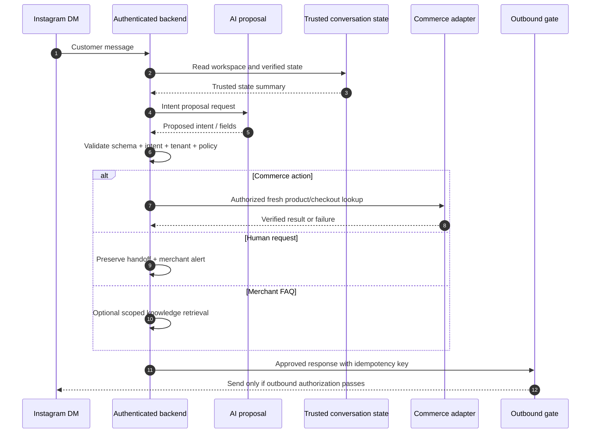
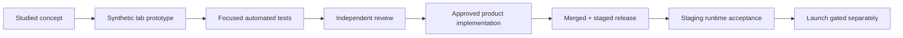

# Chatout + GenAI — architecture and safety boundaries

**Status note:** This is a **proposed learning/reference architecture** based on discussed Chatout behaviour and regressions; it is **not** a claim that LangChain, LangGraph, RAG or a new microservice is deployed.

## Product goal

Chatout helps Instagram merchants connect to Shopify first (later WooCommerce/custom stores), answer product inquiries and move customers toward verified purchase outcomes. The core reliability requirement is **verified commerce data plus multi-turn continuity**.

## Functional separation

```mermaid
flowchart TD
 A[Instagram customer DM] --> B[Backend: auth, workspace and conversation state]
 B --> C[Existing AI-service: propose meaning and response]
 C --> D[Strict schema / parser validation]
 D --> E{Backend policy + trusted state}
 E -->|Product/stock/price/checkout| F[Authorized commerce integration: Shopify first]
 E -->|Merchant FAQ (optional future)| G[Tenant-scoped knowledge retrieval]
 E -->|Human requested / risk| H[Handoff and merchant alert]
 F --> I[Verified result / safe reply]
 G --> I
 H --> I
 I --> J[Outbound gate, audit and idempotent send]
 K[Isolated GenAI learning lab] -. no production effects .-> C
```

## Trust boundaries

| Data / operation | Source of truth | AI allowed? |
|---|---|---|
| User's language and proposed intent | DM + model, validated | Propose only |
| Selected item and quantity | Trusted conversation state and user confirmation | Suggest / clarify |
| Current price, stock, variants | Commerce API/backend lookup | **No** unverified claims |
| Checkout URL / order creation | Approved backend transactional flow | **No** independent side effects |
| Store return/shipping FAQ | Approved merchant document, scoped retrieval | Grounded summary only |
| Workspace / tool privileges | Authenticated backend context | **Never** decided by model |
| Human takeover | Backend policy + explicit customer signal | Must preserve and route |

## Current architecture vs candidate design

- **Observed historical problem:** checkout request at turn 4 lost product context; classification and backend recovery both required fixes. There was also a mixed checkout/human-handoff regression scenario.
- **Proposed experiment:** typed intent + trusted conversation state + explicit handoff flag + simple deterministic state machine. A LangGraph-like graph is optional; compare with ordinary functions before adopting.
- **Proposed RAG use:** approved merchant policy and FAQ documents only. Do not put fast-changing inventory/order state into knowledge retrieval as the authoritative path.
- **Operational gates:** no live Instagram send until approved and explicitly enabled; record runtime evidence independently of local tests/PR review.

## Safety and data handling rules

1. Resolve `workspace_id` from authenticated backend context, not from customer message or uploaded policy.
2. Keep access policies server-side. A prompt or retrieved chunk cannot grant tool permissions.
3. All write-side calls need explicit preconditions and idempotency keys. Checkout success must be confirmed by the authoritative service.
4. Tool failures, timeouts, parse failures and ambiguity have defined **no-side-effect** fallbacks.
5. Audit proposed and executed actions separately, with redacted logs, trace IDs, latency and error categories.
6. Data deletion must remove related knowledge vectors and metadata as required.

## Release discipline

Learning result → isolated test proof → independent review → integration proposal → explicit approval → focused regression tests → batched staging release → runtime acceptance. **Do not mark Done before the required evidence.** Existing Chatout master Excel remains the only product tracker.

## Visual: trust is enforced by the backend, not the LLM



### Three invariants an architecture review should enforce

1. **A model-generated product identifier is never trusted without backend state and scope checks.** A plausible product string cannot cross the authorization boundary by itself.
2. **Intent classification, policy evaluation and side-effect execution must be separate steps.** The system can interpret “checkout” without being authorized or technically ready to create a link.
3. **A mixed human request is independently preserved.** If the message asks for a link *or* a seller, checkout inference must not silently erase the human signal.

## Visual: status progression needs evidence



The GenAI learning notes record concepts and proposed experiments; they are **not proof** any stage beyond learning has been completed. Real Instagram sending remains subject to the project's live-send and Meta permissions gates.

### Review prompts for the engineering team

- What is the trusted source of **workspace ID**, and can a model override it?
- Which component owns **current stock/price**, and how is a stale result handled?
- Where is the **idempotency boundary** around possible duplicate checkout or message sends?
- What metric distinguishes **misclassification** from **parser rejection** and **authorization denial**?
- When a user says “talk to a human”, is the merchant alert traceable from logs to runtime outcome?

**See the complete visual story:** [Visual atlas](../visual-atlas.md).
