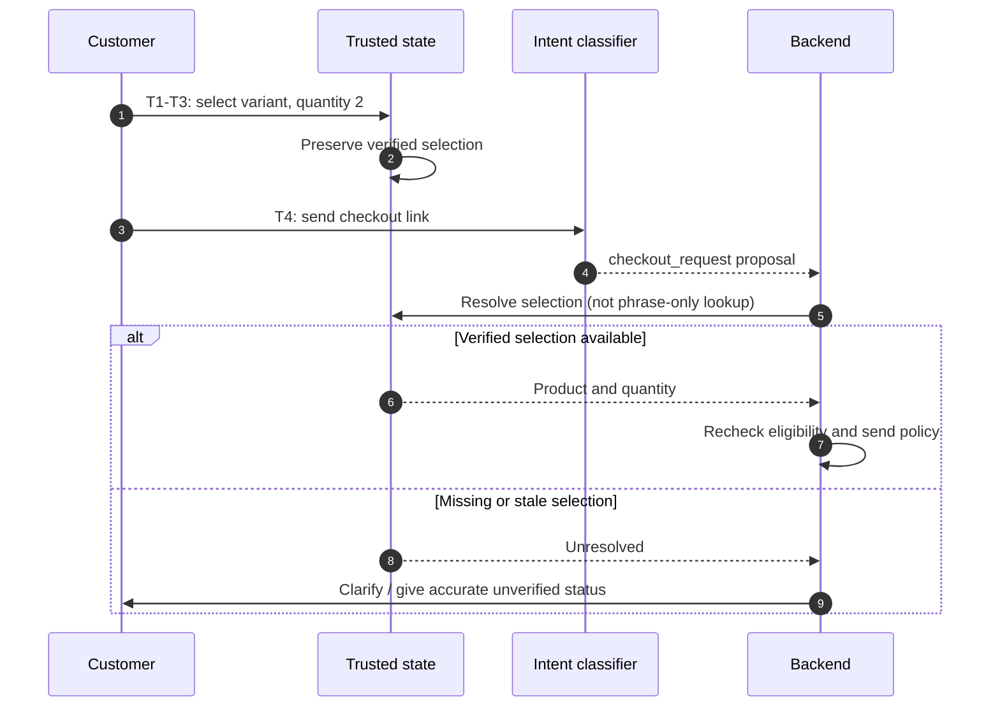
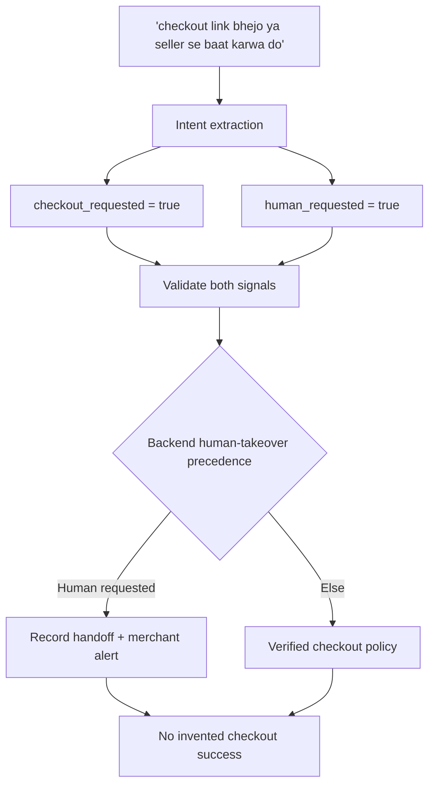

# Real Chatout cases mapped to GenAI lessons

These cases are **learning inputs** from earlier discussions, not a verified statement about current production/staging status. They should be represented as synthetic regression fixtures in the isolated lab.

## Case A — Checkout request loses multi-turn context

```text
T1: I am looking for ski wax.
T2: The special selling plan looks good.
T3: I want 2.
T4: Great, please send me the checkout link.
```

**Historical observed failure:** turn 4 was handed off as `low_confidence` because model classification did not retain checkout intent and backend recovery did not resolve selected product from earlier state. Fixes were merged, but this alone is not final end-to-end staging acceptance.

**Lessons:** role-aware prompts, memory/state, typed intent outputs, conditional routing and deterministic product-selection recovery. A model response alone must never be used as proof a checkout was created.

**Fixture expectation:** classify checkout intent; recover earlier **verified** selection if valid; verify price/stock/checkout readiness; otherwise respond with safe clarification or verified status.

## Case B — Mixed checkout and human handoff

```text
"Checkout link bhejo ya seller se baat karwa do."
```

**Historical regression:** single-choice intent logic could miss the human request. Avoid the assumption that human handoff and checkout intent are mutually exclusive.

**Lessons:** structured output with independent `human_requested` flag or multi-label intent, conditional chains, stateful transitions and explicit handoff policy.

**Fixture expectation:** preserve both signals; produce no unverified checkout link; follow configured human-takeover policy and do not lose the merchant alert requirement.

## Case C — Merchant-specific knowledge vs live commerce

```text
W1: "Can I return it after 10 days?" / Merchant policy = 7 days.
W2: same question / Merchant policy = 14 days.
```

**Lessons:** loaders, metadata, splitters, vector stores, retrievers, RAG, source citations, isolation and deletion. A retrieval answer must not leak W2's policy to W1.

**Fixture expectation:** W1 gets its policy (and no unsupported exception); W2 gets its different policy. No policy answer is fabricated when evidence is absent.

## Case D — Future inputs: screenshot or reel reference

A merchant customer may send a product screenshot or mention a product from a reel. These are **future scope scenarios**, not completed capabilities. A multimodal model can propose candidate SKUs, but product match must be verified against workspace catalog and customer context before price/stock or checkout.

**Lesson:** tool use + uncertainty handling. Image similarity or a reel description alone is **not** product identity proof.

## Recommended regression labels

`checkout_turn4_context`, `mixed_checkout_handoff`, `workspace_isolation`, `stale_policy`, `prompt_injection`, `unverified_stock`, `retry_idempotency`, `unknown_product`, `tool_timeout`.

Record for each case: input turns, trusted state fixture, expected typed proposal, expected backend decision, expected external side effects (**usually zero**), and evidence link once executed.

## Visual case review — four-turn checkout recovery



**Historical root cause:** A prior AI classification path cleared checkout intent without an explicit product phrase, and a backend recovery path relied too heavily on a phrase in the current message. Both layers needed corrections. The diagram models the **desired acceptance behaviour**; it is not a claim that staging acceptance is complete.

## Visual case review — mixed intent and human takeover



**Important:** “or” does not permit dropping a human request just because the model selected a checkout intent. The backend must apply the configured human-handoff policy and keep an auditable merchant alert when required.

### Regression fixture design

| Test input | Invariant | Expected safe result |
|---|---|---|
| T4 checkout, earlier verified W1 product | State continuity | Resolve trusted selection; fresh commerce check |
| T4 checkout with no verified product | No fabricated selection | Ask clarification |
| Mixed checkout + seller request | Preserve both signals | Human-handling policy / alert, no fake link |
| W1 DM proposes W2 product | Tenant isolation | Deny foreign selection |
| Commerce API times out | No false success | Report unverified state or handoff |
| Replayed checkout event | Side-effect idempotency | No duplicate action |
| Prompt injection from merchant PDF | Separation of data and rules | Ignore malicious instruction |

### Root-cause writing template for the next incident

Describe **trigger**, **trusted state available**, **model proposal**, **backend decision**, **observed result**, **expected result**, **evidence and runtime proof**, then **one narrow regression test**. Avoid converting an incident note into a speculative architecture rewrite until the original failure is fixed and accepted.

**See also:** [Architecture](architecture-and-safety.md) · [Visual atlas](../visual-atlas.md).
