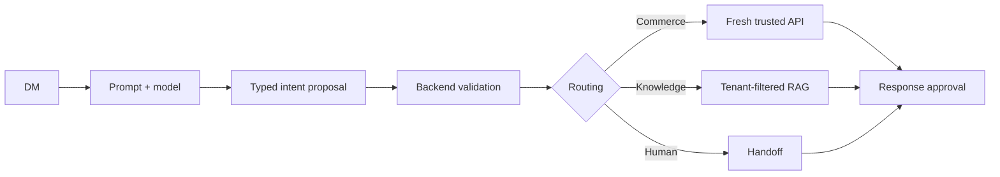

# GenAI + SRE / Platform / Agent interviews

These are compact answers to practise aloud and expand with actual lab evidence once available.

### Q1. What is an LLM, and why can't it own checkout?

A probabilistic language model predicts useful responses, not authoritative stock/order state. Use it to **propose intent**; verify selection, permissions, price, inventory and payment action with deterministic services.

### Q2. LangChain vs LangGraph?

LangChain provides reusable model, prompt, retrieval, parser and runnable building blocks. LangGraph focuses on explicit **stateful graph orchestration**, including branches, cycles, checkpoints and handoffs. A graph is useful when dynamic multi-step state management is warranted; do not add it to simple pipelines by default. **This is a preview of the next lesson, not proof that it is completed.**

### Q3. What is the difference between an output parser and structured output?

Structured output constrains the model's returned shape; parsers validate/convert model output for code. Both require independent semantic/authorization validation.

### Q4. TypedDict vs Pydantic vs JSON Schema?

TypedDict helps Python static typing; Pydantic validates runtime Python data; JSON Schema defines interoperable schema constraints. None alone proves a model-generated product ID is authorized.

### Q5. What is RAG and how is it different from fine-tuning?

RAG retrieves external authorized evidence at question time and grounds model responses. Fine-tuning updates model behaviour/weights. RAG does not require fine-tuning; both have different maintenance/safety implications.

### Q6. What is a vector store and why Chroma?

Embeddings represent semantic similarity, and a vector store retrieves nearest candidate passages. Chroma can be convenient for local prototypes. Production choice depends on isolation, scale, delete/update correctness, latency and operations; existing Postgres can coexist with retrieval infrastructure.

### Q7. How would you prevent tenant data leakage in merchant RAG?

Resolve workspace from trusted auth; filter at storage/retriever layer; verify retrieved metadata; reject stale/unapproved docs; test adversarial cross-workspace questions and deletion; avoid letting the LLM choose tenant filters.

### Q8. How can multi-turn checkout fail?

Loss of state can turn "send checkout link" into generic low confidence when product appears only in earlier turns. Preserve **trusted selection**, validate proposed intent, recover state and independently verify live commerce data.

### Q9. How do you operate an AI agent safely?

Treat the agent as an untrusted planner behind typed tool contracts, authorization, rate limits, timeouts, idempotency, PII-safe logs, human handoff, prompt-injection defenses and observability. Separate model proposal from executed outcome.

### Q10. What evidence would persuade you to deploy a graph-based agent?

A controlled comparison on representative fixtures showing improved multi-turn accuracy, no new checkout/handoff safety regressions, acceptable P95 latency/cost, passed tenant-isolation and retry tests, independent review and explicit release approval.

## Portfolio story

> "I took real Chatout checkout continuity and handoff failure cases, mapped each to GenAI concepts, built isolated experiments with synthetic fixtures, and used SRE gates—validation, tenant isolation, idempotency, traceability and runtime acceptance—to judge whether a new AI pattern actually improves outcomes."

**Be accurate about evidence:** until a lab is run, say "designed a lab experiment", not "implemented/benchmarked it".

## Whiteboard question — draw the system, then explain authority

### A strong answer in 60 seconds

“Chatout needs conversational understanding, but also verified commerce outcomes. I let the language model propose structured intent, then a trusted backend validates tenancy, conversation state and authorization. Price and stock come from the commerce API. Merchant FAQs can use tenant-scoped RAG, but retrieved text cannot initiate checkout. Multi-turn context and mixed handoff are explicit regression tests. We prototype new orchestration in an isolated lab and promote only with test and runtime evidence.”

### Interviewer follow-ups to practise

| Prompt | Distinguish in your answer |
|---|---|
| Why use Pydantic if the provider supports JSON Schema? | Generation constraint vs runtime/semantic validation |
| Why isn't Chroma a replacement for Postgres? | Similarity search vs relational/source-of-truth data |
| What does a retriever return? | Evidence chunks, not final authoritative decisions |
| When would a graph beat a chain? | Stateful branching/cycles **if** benchmark proves it |
| Why not send if the model says “checkout complete”? | Model output is not an effect receipt |
| How do you test tenancy? | W1/W2 adversarial fixtures, strict server-side filtering |
| How do you measure prompt quality? | Reproducible fixtures, error categories, not anecdotal fluency |

**Interview honesty:** Say “I designed a safe lab experiment” unless you actually built, tested, and deployed it. Keeping this distinction sharp demonstrates better engineering judgment than listing more libraries.

**Study path:** [Visual atlas](../visual-atlas.md) → [Course map](../video-to-project-map.md) → [Regression fixtures](failure-cases.md).
