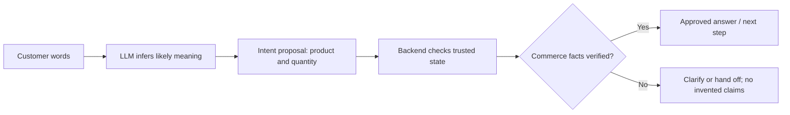

# 01 — GenAI and Large Language Models (LLMs)

## Concept, simple English + Hinglish

Traditional software follows explicit logic. An LLM predicts a useful next sequence of tokens based on the prompt and learned patterns; it is **probabilistic**, not an authoritative business database. A response sounding confident **does not make the answer true**. Prompting guides behaviour; backend validation ensures business correctness.

**User question → input/messages → model → proposed answer**. It is not automatically an agent and does not automatically know the latest product catalog.

## Chatout mapping

Customer: *"Mujhe ski wax chahiye, do pieces aur checkout link bhej do."*

- **LLM is good at:** language understanding, classifying purchase intent, extracting quantity, creating user-friendly responses.
- **Backend is responsible for:** workspace identification, product selection, Shopify record lookup, verified current price/stock, checkout readiness, permission to send.
- **If verification fails:** never fabricate a checkout URL or claim that a cart/order was created.

## Real product failure to remember

In a past multi-turn Chatout test, **turn 4** (*"Great, please send me the checkout link"*) was routed to `low_confidence` because the model and backend lost earlier product context. Fixes were later merged, but this is a reusable **regression test**, not evidence that every variant is accepted in staging.

## Isolated exercise

Prepare 20 synthetic customer messages: greeting, price, quantity, follow-up checkout, handoff and ambiguous intent. Ask a model to output an **intent proposal only**, then compare against labelled expected results. Do **not** call Shopify or send Instagram messages.

## Acceptance checks

- Correct intent for clear checkout follow-ups, **including when product name is omitted**.
- Unknown product or missing evidence must remain unresolved, not invented.
- The same prompt repeated across multiple seeds should produce an acceptably stable validated output.
- Mixed requests (checkout **or** human) must preserve human-request signal.

## Decision

**Use now as a design principle.** LLM for interpretation, deterministic services for facts and effects. **Interview answer:** *"LLMs generate likely text; production agent reliability comes from grounding, state, validation, tool permissions and observability."*

## Visual memory aid — prediction is not verification

### Explain it to a new engineer

The model can understand *“wahi product 2 pieces”* without a perfect grammar match, but it does not know **which product was reliably selected** unless trusted state says so. Its output can be plausible and still wrong. Think of the model as a **language interpreter**, not an order database.

**Wrong design:** “LLM generated a checkout URL, therefore send it.”

**Safer design:** “LLM proposed checkout intent → backend resolves product selection → commerce API verifies prerequisites → outbound policy permits a result.”

**Try mentally:** If the user asks “do you have stock?” and the model has only yesterday's FAQ document, which component can truthfully answer? **The authorized commerce lookup**, not a semantic document match.

**Checkpoint:** What breaks if the model is 99% confident but the product ID belongs to another merchant? The backend must deny it; confidence does not grant access.

**Read next:** [Components and models](02-components-and-models.md) · [Visual atlas](../visual-atlas.md).
