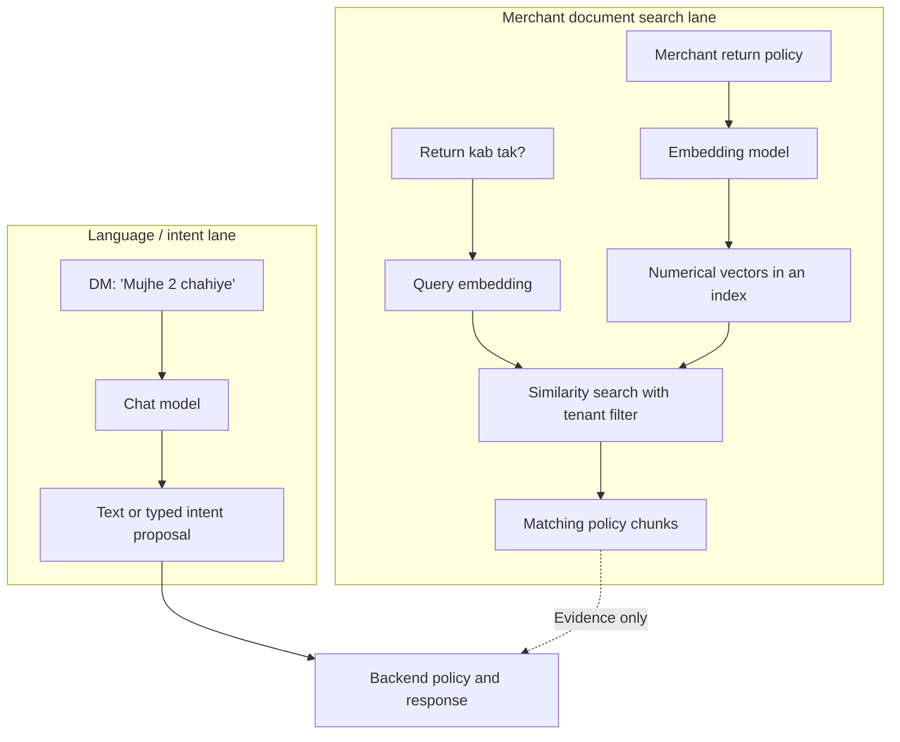

# 02 — LangChain components and models

## Concept

Think in replaceable blocks: **chat model** (understand/generate), **embeddings model** (text → vector), **prompt template**, **output parser/schema**, **retriever**, **tools**, and **orchestration**. A chat model and an embeddings model have different outputs and jobs. A framework is an integration library, **not** a guarantee of safer AI decisions.

```text
Customer DM
   | -> message/state handling -> chat model -> validated intent proposal
   | -> (optional) retriever + merchant FAQ -> grounded answer
   | -> authoritative product/checkout API -> verified business result
```

## Chatout mapping

- Chat model: understand "same item, 2 pieces" in conversation context.
- Embedding model: find relevant merchant shipping-policy text even when words differ.
- Retriever: enforce workspace scope and pick relevant document snippets.
- Typed schema/parser: prevent malformed action data.
- Deterministic backend: own verified Shopify facts and action permissions.

This is a **conceptual design map**; it does not establish that each LangChain component exists inside the current service.

## Mistake to avoid

Embedding similarity is **not** inventory availability. A stored chunk saying "size M available" can be obsolete even if it is the closest semantic match.

## Safe lab

Build two minimal adapters: `fake_chat_model(prompt) -> IntentProposal` and `fake_embedder(text) -> vector`. Mock commerce lookup separately. Swap the fake model implementation without changing the authorization or checkout layer.

## Acceptance checks

- Model failure yields a controlled error or handoff, never an action.
- Embeddings/retrieval cannot bypass commerce verification.
- Tenant/workspace ID is carried through all reads.
- Unit tests mock the model and verify request/response shapes.

## Decision

**Prototype behind interfaces** in the separate learning lab. Avoid installing a framework merely to wrap one static prompt.

## Visual comparison — chat model vs embedding model



### Decision table

| You need... | Reach for... | Do **not** conclude... |
|---|---|---|
| Interpret a DM's meaning | Chat model | Its quantity/product is verified |
| Compare two text meanings | Embeddings | Nearest chunk is authoritative |
| Generate answer grounded in a merchant policy | Retriever + chat model | A policy grants transactional permission |
| Create or validate a checkout | Backend + trusted commerce tools | A model can perform it autonomously |

**Engineering intuition:** A single abstraction called “AI” hides the fact that **generation, similarity search and transactions** have different contracts. Isolate them behind replaceable interfaces before adding a framework.

**Negative test:** Swap the embedding adapter to return identical vectors for all documents. Even if retrieval quality collapses, authorization must still prevent cross-workspace results and checkout effects.

**Checkpoint:** Does a vector store update a Shopify stock quantity? **No.** Live commerce data needs an authoritative integration.

**Read next:** [Prompts and messages](03-prompts-and-messages.md) · [Concept map](../video-to-project-map.md).
