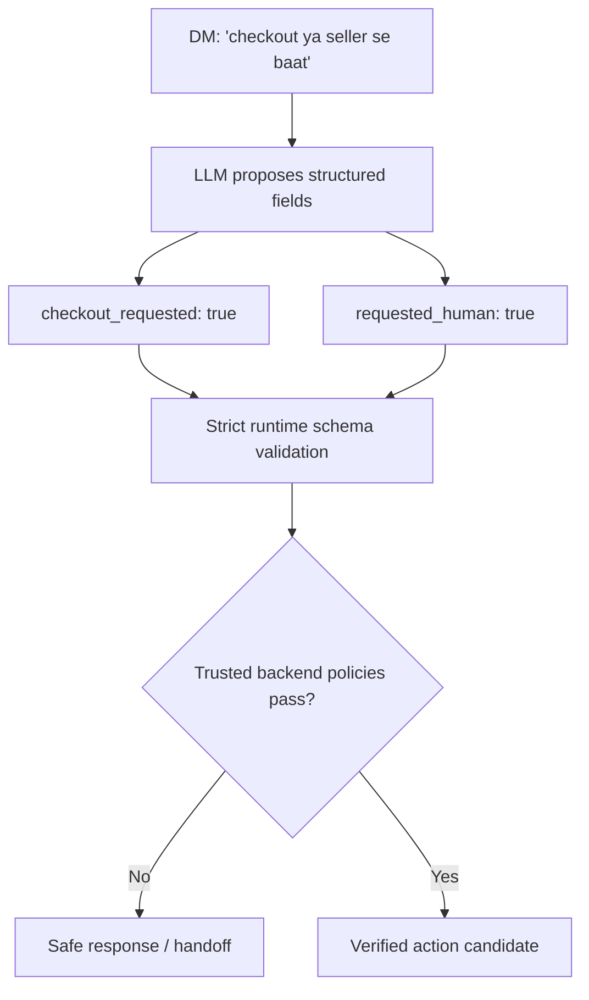

# 04 — Structured outputs (Pydantic, TypedDict, JSON Schema)

## Concept

Instead of a free-text paragraph, ask the model to propose a **typed object**. The server still validates the returned object and its business meaning.

| Choice | Best for | Limitation |
|---|---|---|
| **Pydantic** | Python runtime validation, constraints, coercion controls | Must reject unsafe/default coercions where necessary |
| **TypedDict** | Static Python type hints / simple structures | Does not itself validate arbitrary runtime JSON |
| **JSON Schema** | Language-neutral API contract and provider structured output | Schema adherence alone does not prove business authorization |

## Example (illustrative Python, lab only)

```python
from typing import Literal
from pydantic import BaseModel, Field, ConfigDict

class IntentProposal(BaseModel):
    model_config = ConfigDict(extra="forbid")
    intent: Literal["product_question", "checkout_request", "human_handoff", "unknown"]
    quantity: int | None = Field(default=None, ge=1, le=50)
    product_id: str | None = None
    requested_human: bool = False

# A model response is a PROPOSAL, never authorization to send/create.
```

`requested_human` should not disappear when customer asks *"checkout link bhejo ya seller se baat karwa do"*. Production implementation may need **multi-label intent** or a separate `requested_human` flag; single-label classification alone can lose information.

## Chatout mapping

`IntentProposal` → **validate** → **recover trusted conversation state** → **merchant authorization + commerce lookup** → decide response/action. Never allow model-provided `product_id` alone to choose a product outside the workspace.

## Safe lab / acceptance

- Reject unknown fields, negative quantities, wrong types and missing required inputs.
- Test mixed checkout+human and a bare "send checkout link" follow-up.
- On parse failure: fail closed and log a redacted diagnostic; no checkout or send.
- A valid schema with mismatched workspace/product IDs is still rejected by business validation.

## Decision

**First recommended structured-AI lab**: narrow intent proposal schema + strict validation. Not a production integration without approval.

## Visual contract — parseable does not mean permitted



### Why independent flags matter

A single enum such as **intent = checkout_request** may silently discard **“ya seller se baat karwa do”**. For a safe lab, represent **checkout intent** separately from **human-request signal**, and let backend policy resolve precedence.

**Contract vs truth:**

- **TypedDict:** Python typing guidance; no runtime validation of arbitrary JSON.
- **JSON Schema:** portable shape constraints; some providers use it for structured-generation modes.
- **Pydantic:** runtime model validation; use strict types where implicit coercion is risky.
- **Backend:** authorize tenant, actions and fresh commerce facts *after* schema validation.

**Failure mode:** A valid payload with product ID **P100** belonging to W2 is forbidden for authenticated workspace W1. A schema cannot make it authorized.

**Checkpoint:** Does a valid Pydantic object allow posting to Instagram immediately? **No**. Shape validation is one gate.

**Read next:** [Output parsers](05-output-parsers.md) · [Mixed-intent visual](../visual-atlas.md#4-multi-intent-messages-must-not-erase-handoff).
