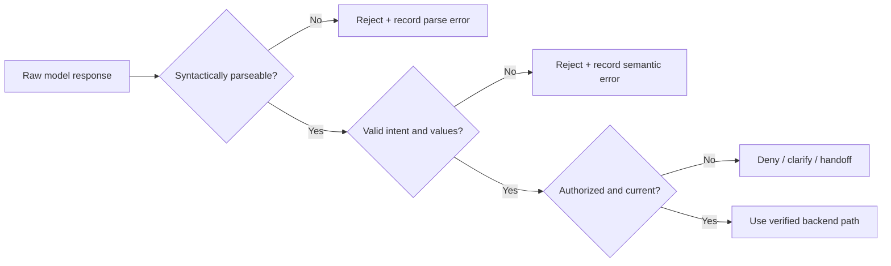

# 05 — Output parsers

## Concept

An **output parser** converts model output into an expected program representation. Examples: `StrOutputParser` returns text; JSON / Pydantic parsers return structured data. Parsers are not a security boundary by themselves: JSON can be syntactically valid but factually wrong.

**Difference from structured output:** model/provider may enforce schema during generation; a parser validates/transforms output after generation. Use both where appropriate and still perform backend-level checks.

## Chatout flow

```text
LLM output -> schema/parser -> validation -> trusted-state recovery
           -> product lookup + permissions -> business action or safe response
```

Example bad response:

```json
{"intent":"checkout_request","quantity":"a lot","checkout_url":"https://invented.invalid"}
```

The parser/schema should reject invalid `quantity`; the backend must **ignore any model-supplied checkout URL**, even if JSON is valid.

## Failure case

A multi-turn checkout request with no product phrase previously fell into low-confidence handling. A parser cannot repair missing state: it only detects output shape problems. **State recovery and classification must both be tested.**

## Safe lab

Feed fixtures covering: valid JSON, markdown-fenced JSON, trailing commas, wrong enum, null quantity, hallucinated product IDs, invented checkout URLs and multi-intent requests.

## Acceptance

- Every malformed or unsupported payload creates **zero external side effects**.
- Error metrics distinguish parser error vs semantic validation vs lookup failure.
- Response contains a safe clarification/handoff rather than silently claiming success.

## Decision

**Use in lab with Pydantic** after structured outputs; do not treat "parse successful" as "transaction approved".

## Three distinct layers — syntax, meaning, authority



**Examples:**

| Model output | Parse status | Meaning / authorization |
|---|---|---|
| Broken JSON | Fail | Never act |
| Correct JSON, quantity = -2 | Parse may succeed | Schema/semantic reject |
| Correct JSON, product from W2 | Parse and schema may succeed | Authorization reject |
| Correct JSON, handoff flag true | Parse succeeds | Backend must preserve human signal |
| Correct JSON, invented checkout URL | Could parse | Ignore model URL; backend must supply any link |

**Implementation clue:** Emit separate **redacted counters** for parsing error, schema rejection, authorization denial, commerce lookup failure, and handoff request. Otherwise “99% parsed” can hide a continuity failure.

**Checkpoint:** Can retrying the model fix wrong workspace authorization? **No.** Retry must not become a security bypass.

**Read next:** [Runnables and chains](06-runnables-and-chains.md) · [Trust boundaries](../chatout/architecture-and-safety.md).
