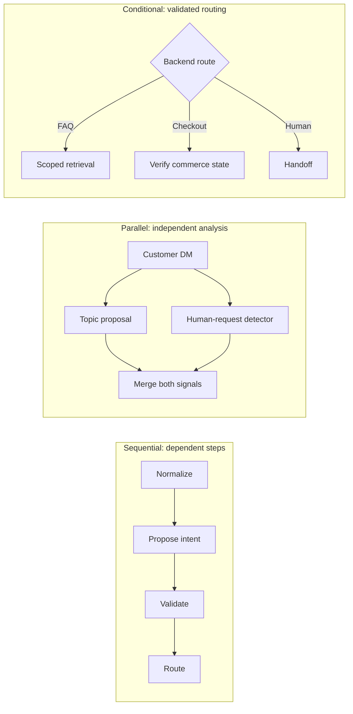
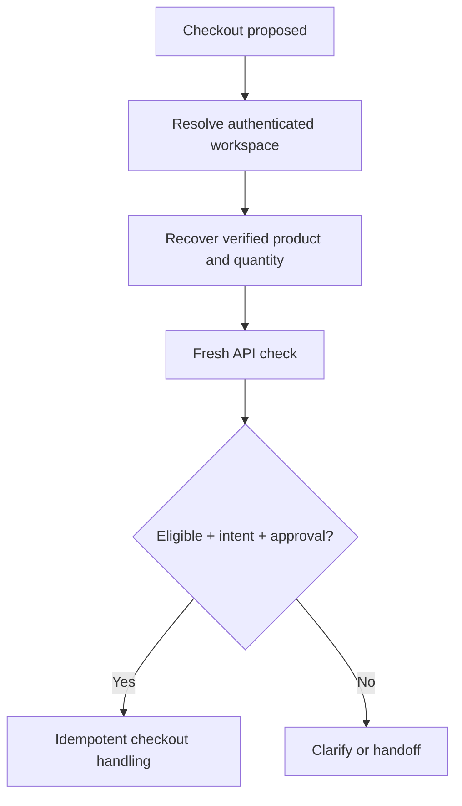

# 06 — Runnables, LCEL and chains

## Concept

A **Runnable** is an interface with operations such as `invoke` (one input), `batch` (multiple inputs) and potentially streaming. In LangChain Expression Language (LCEL), `|` connects compatible runnables. A **chain** links predictable steps.

- **Sequential:** step B depends on output of A.
- **Parallel:** independent tasks run on the same input; results are combined.
- **Conditional:** router chooses a branch based on a validated condition.
- **Agent/graph:** can choose steps dynamically and track more involved state; not necessary for every fixed workflow.

## Chatout design illustration (pseudocode, not installed code)

```text
DM -> normalize -> propose intent -> validate intent
                                  -> checkout? -> recover selection -> verified backend
                                  -> FAQ?      -> optional tenant-scoped retriever
                                  -> human?    -> safe handoff
                                  -> unknown?  -> clarification
```

**Parallel example:** classify topic and detect human-handoff words independently, then merge. Do not perform dependent product checkout steps in parallel with verification.

## Actual regression insight

A single conditional router can choose `checkout` and accidentally erase a separate human request. Preserve independent flags (e.g., `human_requested`) before selecting a safe next step.

## Safe experiment

Implement fake runnables or plain Python functions for normalization, classification and validation. Compare a sequential pipeline to a naive branch router on 20 synthetic multi-turn fixtures.

## Acceptance checks

- Order of side-effecting steps is explicit and enforced.
- Both parts of mixed checkout/human requests survive routing.
- Retry of a side-effect request cannot duplicate checkout/order creation.
- Branch decisions are traceable with redacted IDs.

## Decision

**Use simple deterministic chains for stable tasks**, test conditional routing carefully; delay introducing complex agent orchestration until lab evidence demonstrates value.

## Visual A — three orchestration patterns



**Runnable** is a composable interface (for example invoke/batch); **chain** is a composition of runnable steps. This is a programming model, not automatic reliability. A lab may use plain functions before adopting a framework.

## Visual B — business actions must be ordered



**Do not parallelize** inventory verification with an action that presumes verification succeeded. Independent intent signals can run in parallel; transactionally dependent actions cannot.

**Anti-pattern:** Conditional router chooses checkout and drops independent human_requested=true. Preserve both before routing.

**Checkpoint:** Does the LCEL pipe operator automatically add memory, tenant isolation or idempotency? **No.** Engineer those separately.

**Read next:** [Document loaders](07-document-loaders.md) · [Chain vs agent diagram](../visual-atlas.md#7-chain-vs-bounded-agent-loop).
