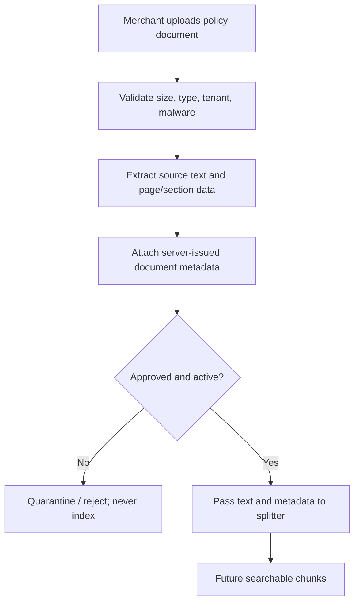

# 07 — Document loaders and ingestion

## Concept

A document loader reads content from a **source** (PDF, TXT, HTML, CSV, etc.) and represents it as text plus metadata. Parsing is only the first step; it does not imply the content is correct, safe, or current.

```text
Merchant upload -> file validation -> loader -> extracted text + metadata
                -> review/sanitization -> splitter -> embeddings -> index
```

## Chatout use case

Merchant uploads return policy, sizing chart, product care instructions or FAQ. The assistant should be able to answer *"return kitne din mein hota hai?"* from the authorized merchant policy, not global model memory.

## Metadata worth keeping

`workspace_id`, `document_id`, `file_name`, `source_type`, `version`, `uploaded_at`, `page_number/section`, `language`, `policy_effective_date`, `approval_status`, `checksum`, `visibility`. Generate IDs server-side. **Never accept workspace ID from document text as authority.**

## Scope and security

- Reject unsupported file types / oversized uploads, and scan untrusted files.
- Do not store plaintext secrets, personal contact details or customer chats as vector data in this lab.
- Track document deletion and index invalidation; a removed policy must not remain retrievable.
- Preserve origin/page metadata to support evidence and citations.

## Safe experiment / acceptance

Upload two synthetic merchants' distinct policies. Extract text and page references, then assert every chunk retains correct tenant and document version. Verify corrupt PDF handling and deletion invalidation without affecting other merchants.

## Decision

**Optional future merchant knowledge module** in separate GenAI lab. It is not necessary for authoritative Shopify facts and must not be treated as already built.

## Visual — document ingestion begins with provenance



### A real example

A merchant uploads a return-policy PDF. The loader's job is **not** to decide whether returns are allowed. It extracts *what the document says* and where it came from; the business approval workflow decides whether that source may be used.

| Record | Why it matters |
|---|---|
| Workspace ID | Prevent policy leakage across merchants |
| Document ID + version | Detect stale vectors after policy edits |
| Page or section | Cite precise evidence |
| Approval state + effective date | Avoid drafting from unpublished/expired policies |
| Checksum and upload time | Deduplicate and trace ingest history |

**Architectural boundary:** Document text is **untrusted** even when uploaded by a merchant; no line inside the file can change application authorization.

**Negative case:** Corrupt PDF or a fake document claiming another workspace ID must not be indexed into that workspace. The authenticated upload context wins.

**Checkpoint:** If text extraction succeeds, does that guarantee the content is current policy? **No**. Extraction, review, versioning and approval are separate stages.

**Read next:** [Text splitters](08-text-splitters.md) · [RAG visual](../visual-atlas.md#5-rag-has-two-separate-pipelines).
