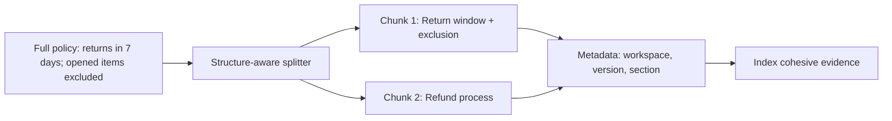

# 08 — Text splitters: chunks, overlap, boundaries

## Concept

Models and retrievers work better with **smaller coherent chunks** than a huge mixed document. `chunk_size` is **not always words**: depending on splitter/length function it may count characters, tokens, or custom units. `chunk_overlap` repeats a part of adjacent chunks to retain context.

Common methods:

- **Character/length-based** for simple text.
- **Recursive character** using progressively smaller separators (paragraph → line → space).
- **Structure-aware** splits by headers, sections, HTML/Markdown boundaries.
- **Language-aware** splitting for source code (e.g., preserve Python function blocks where possible).
- **Semantic splitting** groups related ideas using embeddings, usually costlier.

## Chatout example

Return policy: "Refunds within 7 days. Exceptions: consumables excluded." Splitting the exception away from its rule may lead to an unsafe incomplete answer. Keep section names and relevant qualifying clauses together.

## Safe experiment

Compare two chunking strategies on synthetic merchant documents. Record chunk size **units**, overlaps, number of chunks, metadata retention and retrieval quality. Sample start: 500 characters with 75-character overlap; this is only a **baseline to measure**, not a universal recommendation.

## Acceptance checks

- Answers cite both rule and its exception where required.
- No chunk loses `workspace_id`, `document_id`, page/section or version.
- A changed policy re-index invalidates the previous version.
- No artificial duplicates overwhelm top-k results.

## Decision

**Lab-only tune with evaluation data.** Prefer readable, policy-aware chunks over picking a magic number.

## Visual — keep a rule and its exception together

### Why arbitrary splitting fails

Imagine the policy text:

> Returns within seven days. **Opened consumables are excluded.** Refund to original payment method.

A careless fixed boundary might make chunk 1 say *“Returns within seven days”* and chunk 2 contain only the exception. Retrieving chunk 1 alone would produce a misleading answer. **Chunk quality is a correctness problem**, not just an indexing detail.

**Practical knobs:** Character count, token count and word count are different measures. Document the length function used before tuning **chunk_size** and **chunk_overlap**. Overlap preserves local context but increases index size and may duplicate retrieval results.

**Lab comparison:** (A) recursive character splitting; (B) section-aware splitting. Evaluate policy question → correctly retrieved clause **and its exclusion**, not merely vector similarity.

**Negative case:** Updating a 7-day policy to 14 days must evict or hide the previous version's chunks. A good splitter cannot solve stale indexing alone.

**Checkpoint:** Is a 500-character chunk universally right? **No**. Pick a baseline, measure quality, then tune.

**Read next:** [Embeddings and vector stores](09-embeddings-and-vector-stores.md) · [RAG visual](../visual-atlas.md#5-rag-has-two-separate-pipelines).
