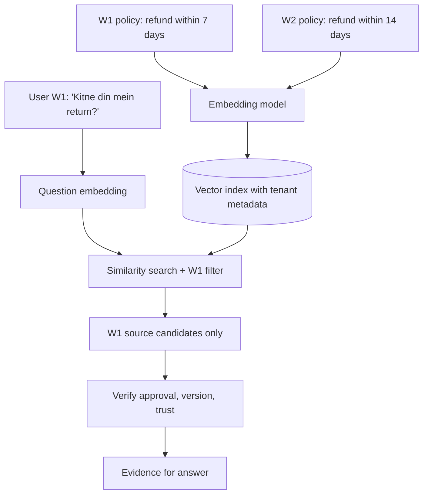

# 09 — Embeddings, vector stores and Chroma

## Concept

An **embedding** maps text to a numerical vector such that related meaning is often near in vector space. A **vector store/index** supports nearest-neighbor search. A general relational database (e.g., PostgreSQL) and a vector store serve different tasks; one does not make the other obsolete. `pgvector` can support vector retrieval in Postgres, while **Chroma** is a useful local lab prototype.

```text
"Delivery kab hogi?" -> query embedding
Merchant policy chunks -> precomputed embeddings
Similarity + tenant/document filters -> retrieved source passages
```

Similarity ≠ truth, business authorization, current stock or guaranteed answer.

## Chatout boundary

Store stable merchant FAQ/policy content (if approved), but retrieve real-time **price / inventory / checkout / order details** from a trusted commerce integration. Distinguish semantic similarity from exact SKU matching.

## Minimal lab record

```json
{
  "id": "w1-doc7-chunk2",
  "text": "Returns accepted within 7 days ...",
  "metadata": {"workspace_id":"w1","document_id":"doc7","version":2,"section":"returns"}
}
```

## Safe experiment

Create two fake merchant workspaces with intentionally similar policies but opposite return windows. Index into local Chroma (or test doubles). Search from W1 and insist W2 results are never returned.

## Acceptance checks

- `workspace_id` is applied as a mandatory server-derived filter.
- Re-index updates old chunks; delete removes all obsolete vectors.
- Retrieval hit-rate and wrong-tenant result count are logged.
- No LLM answer can override live Shopify authority.

## Decision

**Prototype** embeddings/Chroma locally. Choose production storage only after measuring scale, isolation, deletion, costs and operations.

## Visual — semantic similarity is a retrieval signal



### Mental model

An embedding is a list of numbers representing patterns in text. Similar meaning often yields nearby vectors. It does **not** carry a guaranteed logical or factual relationship. The nearest result could be outdated, wrong, or malicious.

**Postgres vs Chroma:** PostgreSQL remains a strong home for transactional entities and conversation state. Chroma can serve as a convenient local vector experiment. pgvector is another possible vector retrieval option **inside Postgres**; choose by measured tenancy, deletion, scale and operations needs, not hype.

**Tenant safety:** Enforce filtering **inside the retriever/storage query** using the authenticated workspace. Validating *after* retrieving wrong-tenant chunks alone is weaker and may leak data through logs or downstream context.

**Evaluation idea:** Construct intentionally near-identical W1 and W2 policies with opposite windows. Verify **zero wrong-tenant candidate passages**, even at top-k 20.

**Checkpoint:** Would a nearest-neighbour hit be reliable evidence that Shopify currently has two units in stock? **No**, use live commerce source.

**Read next:** [Retrievers](10-retrievers.md) · [SQL vs vector diagram](../visual-atlas.md#6-sql-data-and-vector-search-solve-different-problems).
