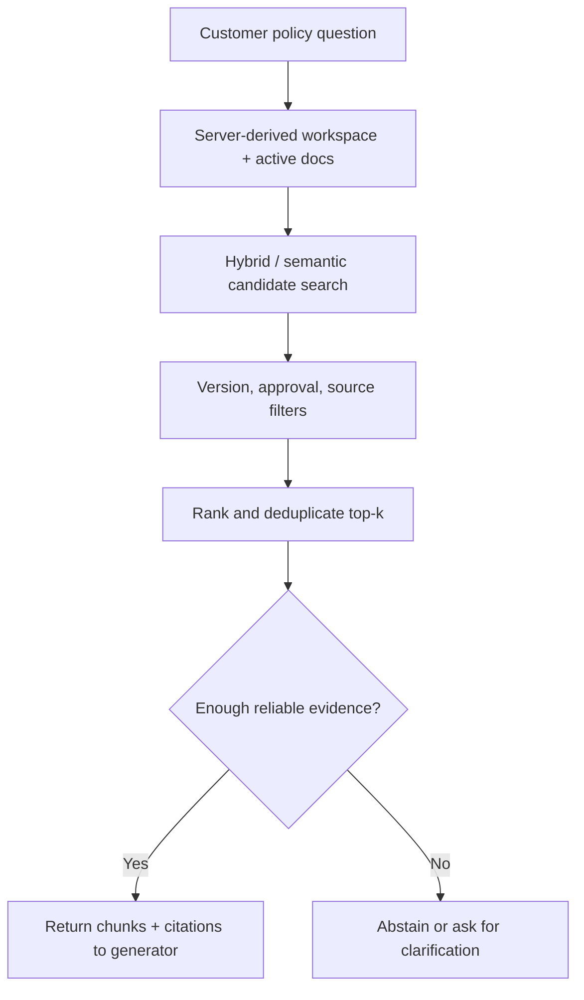

# 10 — Retrievers and retrieval quality

## Concept

A **retriever** takes a query and returns relevant documents/chunks; it does not itself compose the final answer. Search may be semantic, keyword, hybrid or filtered. Core knobs: **top-k**, similarity thresholds, metadata filters, reranking and deduplication.

## Chatout scenario

DM: *"Aapki jacket wash karne ka proper method kya hai?"* Retrieve this merchant's **product-care guidance**, then answer only from accepted current sources. If no relevant evidence exists, ask for clarification or handoff.

```text
Query -> normalize -> server-derived workspace filter
      -> vector/keyword retrieval -> trust & version checks
      -> evidence chunks -> answer synthesis with source links
```

## Important distinction

Top-k = 5 means **five nearest items**, not "five correct documents". A high score may still point to outdated content. Enforce `approved=true`, `document_version=latest`, `workspace_id` and suitable source freshness.

## Safe lab

Create 30 synthetic customer questions against 10 policy documents; label the acceptable source documents. Compare semantic-only retrieval vs metadata-filtered retrieval on the same fixture set.

## Acceptance checks / metrics

- **Recall@k**: fraction of questions where the expected source appears in the top-k.
- **Precision@k**: fraction of returned items relevant to each question.
- **Cross-tenant leakage**: must be exactly zero in adversarial fixtures.
- **No-evidence behavior**: reject unsupported confident answer.
- **Staleness**: old/revoked version never selected.

## Decision

**Lab after loaders/splitters/stores**, not a prerequisite to normal checkout handling.

## Visual — retrieval is a ranked search, not final truth



### Quality vs safety are different axes

| Metric / check | Answers the question |
|---|---|
| Recall@k | Was the necessary source among returned candidates? |
| Precision@k | How many retrieved chunks are relevant? |
| Citation correctness | Does the cited text actually support the answer? |
| Tenant isolation | Was *any* wrong workspace material returned? |
| Document revocation | Are removed/older versions absent? |
| Latency / cost | Can this operate within the target user experience? |

**Top-k does not mean k correct answers.** Similarity score can be high for irrelevant or obsolete passages. Search the right allowed corpus *before* ranking; then validate source and version.

**Controlled fallback:** On no evidence, answer “I don't have a verified policy for that yet” or route to a merchant; do not fill the gap from model imagination.

**Negative case:** Force a search timeout or zero hits. The model must not silently claim a specific return window.

**Checkpoint:** Does a retriever write the final DM response? Usually **no**. It supplies documents; generation/formatting comes later, behind policy checks.

**Read next:** [RAG](11-rag.md) · [RAG visual](../visual-atlas.md#5-rag-has-two-separate-pipelines).
