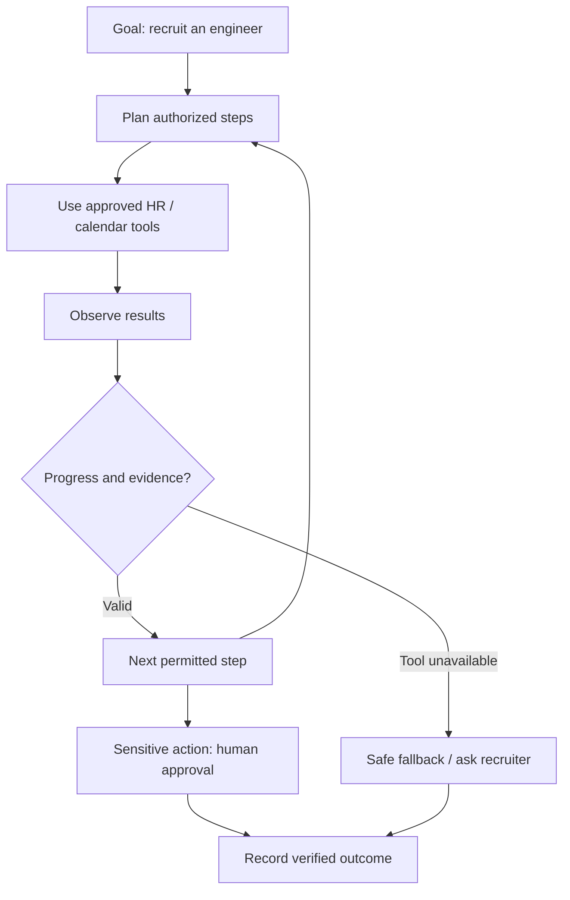
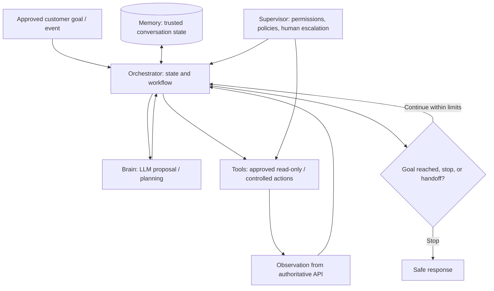
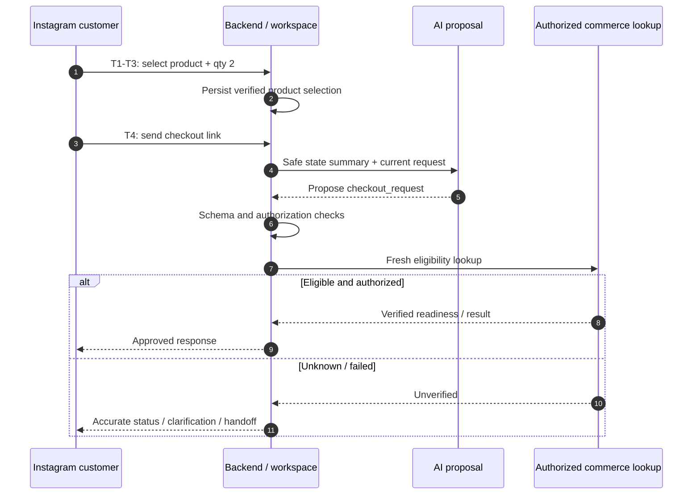
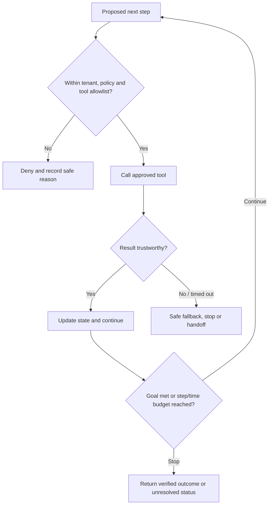

# Video 2 — What is Agentic AI? (CampusX)

**Learning status:** Video 2 completed; knowledge-check **B correct (1/1)**; hands-on lab not yet completed. [Original lesson](https://www.youtube.com/watch?v=GWnSsjT4V68).

## The practical definition

An AI agent is not just an LLM that sounds proactive. In this lesson, the instructor revisits the **backend-engineer recruitment problem** to explain *goal setting, planning, reasoning, memory, tool use, feedback, error handling and human oversight*. In real software those capabilities need an orchestrator, state and safety boundaries.

**Simple Hinglish:** Goal mila → plan banao → allowed tool use karo → observation dekho → state update karo → next safe decision lo → stop ya human ko involve karo. Har step ki permission application control karegi.

## How the course's recruitment example works

**Goal:** Hire a remote backend engineer with an appropriate experience range.

A conceptual workflow: recruiter defines role → system drafts JD → gets approved policy/templates → requests job-posting action → tracks applicants → evaluates against specified criteria → coordinates interview scheduling → returns status. If calendar integration fails, it **should not invent an interview time**. It may propose to ask a recruiter for availability.

The same failure principle directly maps to Chatout: if Shopify checkout readiness is unknown, it cannot claim a link was created or sent.

**Notice:** The loop must have **termination conditions**. Without step limits, status checks and policy checks, the system could retry indefinitely or generate false progress.

## Five components: a useful mental architecture

This is a conceptual decomposition, **not a claim about Chatout's deployed classes**.

| Component | Recruitment analogy | Chatout proposed analogue | A failure to prevent |
|---|---|---|---|
| **Brain** | Interprets role criteria and suggests next step | Proposes intent, missing info, next read-only lookup | Unreliable model output treated as fact |
| **Orchestrator** | Tracks progress through hiring stages | Controls verify / clarify / handoff transitions | Loop or branch loses human signal |
| **Tools** | HR database, calendar, job board | Scoped merchant FAQ retrieval; trusted Shopify lookup | Cross-tenant or unauthorized action |
| **Memory** | Tracks candidate and scheduling context | Backend-stored verified product, variant, quantity, handoff state | Turn 4 loses earlier selection |
| **Supervisor / policy** | Approves rejection, outreach, offers | Backend permissions, merchant alert, checkout gating | Model sends unapproved checkout or message |

**Terminology nuance:** “Brain/orchestrator/tools/memory/supervisor” is a practical explanatory architecture. Real systems can merge/split responsibilities. A model alone does not “have memory” unless the application supplies stored state.

## Planning vs reasoning vs action

| Capability | Meaning | Chatout example |
|---|---|---|
| **Planning** | Outline steps toward the goal | Identify need: verify selection → stock → safe checkout status |
| **Reasoning / decision-making** | Evaluate evidence and choose a permitted next step | If variant unknown, ask clarifying question, not invent size |
| **Tool use** | Query or invoke a defined interface | Read-only fake Shopify catalogue lookup |
| **Memory/state** | Preserve verified context across turns | Store selected SKU and quantity in authenticated backend |
| **Observation/feedback** | Update next step using results | If out of stock, stop checkout route, suggest verified options |
| **Human-in-the-loop** | Escalate or request approval where needed | Customer explicitly requests seller/human |
| **Adaptability** | Recover or switch among allowed paths | Merchant API times out → safe unknown-status response |

**Not the same:** Planning describes a strategy; *execution* is a separately governed action. A good plan cannot grant its own permissions.

## Chatout flow: black shoes versus ski-wax checkout

Scenario A: Customer asks for **black running shoes**. Tool finds only a white variant. Agent may **suggest a clarification or verified alternative**, not falsely call the white variant black.

Scenario B: Customer previously selected ski wax quantity 2, then says **“Send the checkout link.”** Agent's intent proposal should preserve checkout meaning, while the backend recovers *trusted* selection and checks readiness. No model-generated URL counts as a successful link.

## How agentic systems should respond to failures

**Recruiter case:** Calendar API unreachable → do not fabricate a scheduled interview; ask for human availability or retry under bounded policy.

**Chatout case:** Shopify timeout → never tell customer “checkout successfully generated” without verified backend evidence. Keep a deduplication key for any *potential* side effect and recheck state after delivery uncertainty. **Retries are not permission to duplicate transactions.**

**Mixed-message case:** “Checkout link bhejo **ya seller se baat karwa do**.” Preserve checkout_request **and** human_requested. Backend decides precedence; merchant alert cannot silently disappear.

## When **not** to build an agent

If the workflow is stable (classify → validate → read-only lookup → respond), deterministic functions or a small chain are often easier to test, more predictable and cheaper. LangGraph offers orchestration primitives for stateful workflows, but its use must be justified in the **separate lab**. No current lesson proves that replacing Chatout's existing orchestration improves production reliability.

## Knowledge check — apply the lecture

**MCQ 1:** A customer says “seller se baat kara do.” The AI identifies checkout intent too. What is correct?

A. Ignore human request because checkout has higher model confidence.
B. Preserve both signals and enforce the backend human-takeover policy.
C. Send an invented link to finish faster.
D. Retry until the model chooses one label.

**Answer: B.** Two signals may coexist; selecting one enum must not erase a safety-relevant request.

**MCQ 2:** A model chooses a checkout tool, but inventory API times out.

A. Assume success based on intent.
B. Report the verified status is unknown and follow bounded recovery.
C. Generate a plausible URL.
D. Disable audit.

**Answer: B.** No tool result = no proof of success.

**Recorded class quiz:** Prior discussion had **B / 1 correct** for Video 2. The two MCQs above are *practice*, not an additional scored attempt.

**Next:** [Chatout mapping](03-chatout-case-study.md) · [Lab blueprint](04-isolated-lab-blueprint.md).
