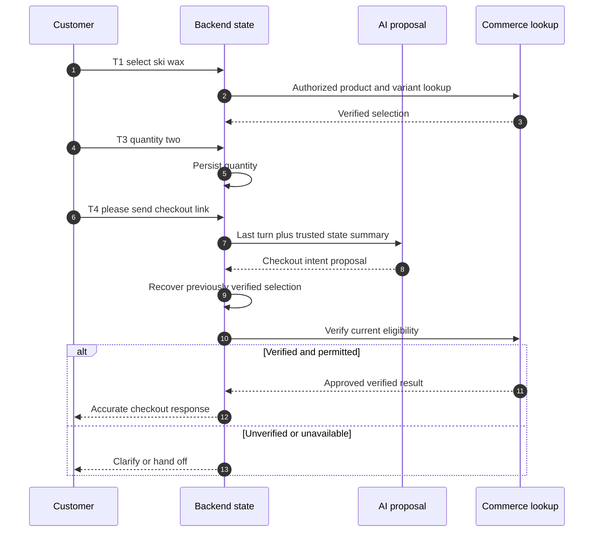
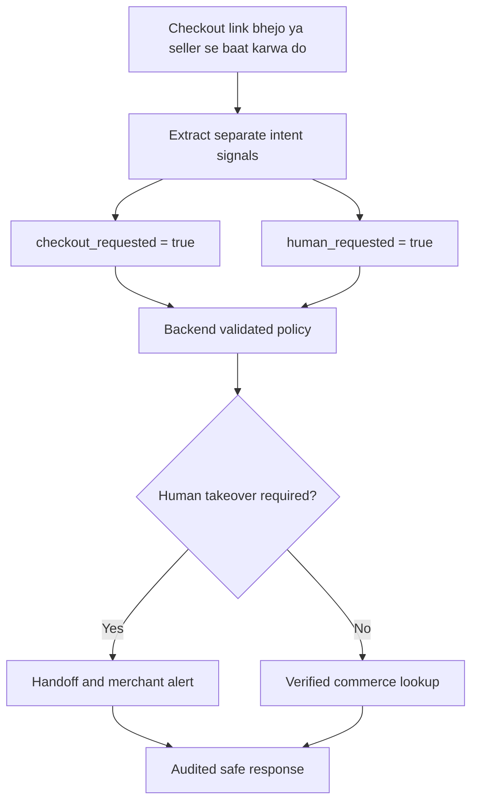

# 03 — Chatout case study: translating the recruiter example

> Design exercise only. Videos 1–2 cover conceptual agentic AI; no LangGraph lab or Chatout deployment is claimed.

## Recruiter → merchant workflow

| Recruitment example | Chatout equivalent | Trusted authority |
|---|---|---|
| Draft job description | Interpret customer product inquiry | LLM proposal, backend validation |
| Consult hiring policy | Retrieve return/shipping FAQ | Approved workspace-scoped documents |
| Look up candidates | Find matching product variants | Authenticated commerce API |
| Arrange interview | Prepare verified checkout path | Backend transaction policy |
| Escalate to recruiter | Seller/human takeover | Backend handoff policy |
| Track candidate progress | Persist conversation/selection state | Trusted database |

## Historical multi-turn checkout failure

Customer sequence: T1 need ski wax → T2 select variant → T3 quantity 2 → T4 send checkout link. Historically T4 classification lost checkout intent when there was no product phrase, and backend selection recovery also failed. Fixes were merged, but this is not blanket proof of staging acceptance.

## Mixed human request — must not disappear

## State contract

| Field | Owner | Safety rule |
|---|---|---|
| workspace_id | Authenticated backend | Never from model or document |
| verified_product_id, variant_id | Backend after trusted lookup | Revalidate before checkout |
| quantity | Customer input, backend validation | Check limits and consistency |
| checkout_requested | Model proposal | Must not authorize checkout |
| human_requested | Independently preserved customer signal | Apply human takeover policy |
| checkout_status | Verified commerce/backend result | Never inferred from LLM text |
| outbound event ID | Backend | Audit and idempotency |

## Negative test cases

1. A bare T4 checkout request with valid earlier selection: recover state and verify fresh eligibility.
2. No verified selection: clarify, do not invent a product or link.
3. Mixed checkout + seller request: preserve both and enforce handoff policy.
4. Foreign workspace product: deny even if model output parses correctly.
5. Timeout or replay: never claim unverified success or duplicate side effects.
6. Retrieved policy says ignore instructions: treat as untrusted evidence.

## Engineering decision

Start with deterministic mock state recovery in a separate lab. Compare to a bounded graph only after establishing baseline metrics. LangGraph state management cannot magically fix incorrect business state.

Related: [Lab blueprint](04-isolated-lab-blueprint.md) · [Video 2](02-what-is-agentic-ai.md).
