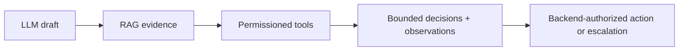

# 05 — Video 1–2 interview and revision notes

## Explain the course using two examples

| Concept | Recruiter example | Chatout example |
|---|---|---|
| Generative AI | Draft a job description | Draft product reply / intent |
| RAG | Read approved hiring policies | Read merchant return policy |
| Tool use | Candidate database / calendar | Trusted Shopify product lookup |
| Agentic choice | Plan next permitted hiring step | Clarify, verify, or hand off |
| Memory | Candidate and schedule state | Verified product and quantity |
| Human oversight | Recruiter approves sensitive action | Seller takeover / transaction gates |

## Interview answers

**Q: Is RAG automatically agentic?** No. A static retrieve-then-generate pipeline need not choose new actions.

**Q: Is calling a tool full autonomy?** No. The application decides tool permissions and may keep next-step selection deterministic.

**Q: What is agent memory?** Application-owned state passed across steps. Free-form model context is not equivalent to verified database state.

**Q: Why not immediately replace Chatout with LangGraph?** Graph primitives cannot fix invalid selection recovery or skipped authorization. Compare a bounded lab against simple functions first.

**Q: What happens when the checkout tool times out?** Maintain an unknown/unverified status, never manufacture a success receipt, respect idempotency.

## Practice MCQs (not historical quiz scores)

1. Model drafts a job description: **B — content generation**, not proof of external action.
2. Company hiring policy needs authoritative evidence: **A — approved RAG source**.
3. Checkout plus seller request: **C — preserve both signals and backend precedence**.
4. API times out: **B — fail safely and report unknown status**.
5. Agent differs from simple fixed chain: **B — bounded next-step decisions based on state and observations**.

## Learning evidence

- Video 1 Generative AI vs Agentic AI: completed by user report; no separate quiz score established.
- Video 2 What is Agentic AI?: completed, prior MCQ **B correct; 1/1**.
- Video 3 LangChain vs LangGraph: next, **not completed**.
- Practical LangGraph lab: **not run or verified**.

Related: [Track index](README.md) · [Study guide](../README.md).
