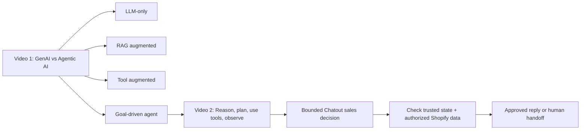
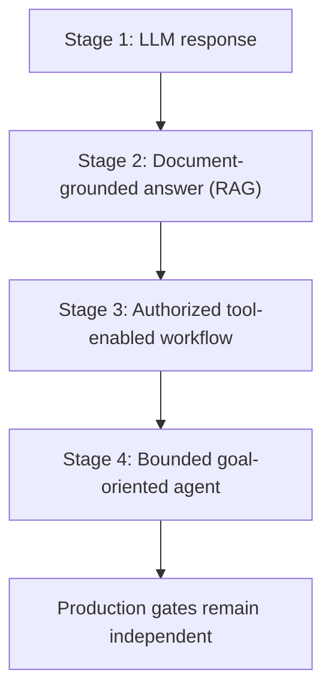

# Agentic AI / LangGraph — Chatout Study Track

> **Status: two foundational lectures completed (user-reported), 27 Nov 2026.** The learning track covers **CampusX Video 1: Generative AI vs Agentic AI** and **Video 2: What is Agentic AI?**. Video 2 has a recorded **1/1 quiz**. Hands-on LangGraph code and the next **Video 3: LangChain vs LangGraph** are **not recorded as complete**.

This is a self-contained, **Chatout-first engineering study guide**, not a production architecture decision. It follows the actual course's **recruiter / hiring scenario**, then translates each step into the Instagram-to-Shopify merchant sales journey. Diagrams and code ideas are independently written learning material rather than copied lecture transcripts.

**Course sources:** [CampusX Video 1](https://www.youtube.com/watch?v=xdA0pGDiUPE) · [CampusX Video 2](https://www.youtube.com/watch?v=GWnSsjT4V68). Related framework reference: [LangGraph documentation](https://docs.langchain.com/oss/python/langgraph/overview).

## Read in this order

| Document | Understand | Chatout application |
|---|---|---|
| [01 — Generative AI vs Agentic AI](01-generative-ai-vs-agentic-ai.md) | Four-stage evolution of an assistant; recruiter example | From answering product questions to safely coordinating a verified sale |
| [02 — What is Agentic AI?](02-what-is-agentic-ai.md) | Planning, reasoning, tools, memory, feedback, autonomy limits | Multi-turn selection, Shopify verification, handoff and safe recovery |
| [03 — Chatout case study](03-chatout-case-study.md) | Translate the recruitment lifecycle into merchant commerce | T1–T4 ski-wax checkout; mixed checkout + seller request |
| [04 — Isolated lab blueprint](04-isolated-lab-blueprint.md) | Turn the idea into falsifiable tests | Synthetic state machine; **no** live checkout/Instagram calls |
| [05 — Interview and revision](05-interview-and-revision.md) | Practical explanations, contrasts and MCQs | Explain why an agent must not own stock or transaction authority |

## Concept map

### One analogy to retain

**Recruiter:** Draft a job description → consult company policy → use approved job-board/calendar tools → monitor candidate pipeline and adapt, with approvals.

**Chatout:** Draft a helpful product reply → consult approved merchant FAQs → use authorized Shopify lookup → decide clarify/verify/handoff based on conversation state, **without autonomously initiating live sends or checkout effects**.

> **Critical boundary:** Being “agentic” means choosing and adapting *within granted policy*. It does not mean the LLM becomes the authority for authentication, product IDs, payment, inventory, or merchant permissions.

## Capability ladder — what is being learned, not deployed

| Stage | Extra capability | What does NOT automatically improve |
|---|---|---|
| LLM response | Language understanding / writing | Fresh business data, authorization |
| RAG | Evidence from a merchant's documents | API-driven current stock, checkout |
| Tool-enabled | Can request external data or actions through approved interfaces | Correct tool permissions and side-effect safety |
| Agentic | Can decide next permitted step using observations and stored state | Reliability unless guardrails, tests and recovery are designed |

## Learning vs product status

- **Studied:** conceptual differences, the instructor's hiring use case, agent properties and architecture, mapped here to Chatout.
- **Quiz evidence:** Video 2 knowledge-check B, correct, **1/1**. No score is invented for Video 1.
- **Not yet established:** an executed isolated LangGraph lab, graph persistence integration, production LangGraph adoption, end-to-end acceptance of every Chatout variant.
- **Next class:** CampusX Video 3, [LangChain vs LangGraph](https://www.youtube.com/watch?v=31qyMKNB2RA), **pending**.
- **Product governance:** existing Chatout AI-service remains unchanged, master Excel tracker remains the source of truth, and live Instagram sends require separate approvals.

## Existing study resources

[GenAI handbook](../README.md) · [Visual atlas](../visual-atlas.md) · [LangChain courses](../langchain/01-introduction-llms.md) · [Lab tests](../chatout/lab-experiments.md)

### How to update this folder after each new video

Write the lecture goal, genuine instructor example, your Chatout translation, one Mermaid flow, a specific failure case, a bounded mock experiment, acceptance checks and a separate status for **understood / quiz / executed / reviewed / integrated**. Do not mark work “implemented” simply because the video is complete.
