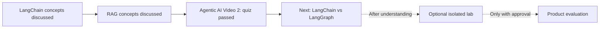

# Learning progress and evidence

**Snapshot date:** 26 Nov 2026. **Source:** our class-wise learning discussions, **not** a code or video-platform completion audit.

| Concept/class discussed | Knowledge status | Hands-on lab status | Chatout engineering decision |
|---|---|---|---|
| Introduction to GenAI and LLMs | Discussed; introductory quiz correct (A) | Not established | LLM for language/intent, not facts |
| LangChain components and models | Discussed | Not established | Keep interfaces modular |
| Prompts and messages | Discussed | Not established | Context + safety instructions, deterministic backend authority |
| Structured outputs (Pydantic, TypedDict, JSON Schema) | Discussed | Not established | Start with strict intent proposal validation |
| Output parsers | Discussed | Not established | Validate all AI-proposed payloads; fail closed |
| Runnables; sequential / parallel / conditional chains | Discussed | Not established | Try for narrow, fixed workflows |
| Document loaders | Discussed | Not established | Optional merchant knowledge ingestion |
| Text splitters | Discussed | Not established | Metadata-preserving chunks |
| Embeddings, Chroma and vector stores | Discussed | Not established | Sandbox retrieval only |
| Retrievers | Discussed | Not established | Tenant-scoped semantic retrieval |
| RAG pipeline and RAG vs fine-tuning | Discussed; RAG quiz answer B | Not established | Merchant policies/FAQs, not volatile commerce facts |
| Agentic AI: What is Agentic AI? (playlist video 2) | Quiz **B**, correct; score **1/1** | Not completed | Explore bounded stateful orchestration in lab |
| LangChain vs LangGraph (next) | **Not yet confirmed complete** | Not started | Teach next; do not assume LangGraph integrated |

> Earlier LangChain class numbering and brief LangGraph introductions varied across discussions. This page tracks **concepts actually discussed**, not a perfect official playlist/video-index mapping. Update the status when a class is explicitly confirmed or a lab is demonstrated.

## How to record a completed practical lab

Copy the following into a new lab note once the experiment has actually run:

```text
Topic:
Date:
Synthetic dataset / fixture version:
Code location + commit:
Command run:
Expected outcome:
Observed outcome:
Pass/fail and failure details:
Security / isolation checks:
Decision: keep in lab | propose promotion | abandon
```

**Do not claim a test passed without its output.**

## Visual roadmap — the next lesson is not already done



**Tracking rule:** This file records **learning knowledge**, not certification, video-platform watch history, code completion or production acceptance. Use “discussed” unless completion and execution evidence were recorded. For each new video, add a link to the corresponding lesson, the quiz answer, a one-sentence Chatout mapping and, separately, proof of any lab.

**Visual map:** [Visual atlas](visual-atlas.md) · [Course-to-project matrix](video-to-project-map.md).
