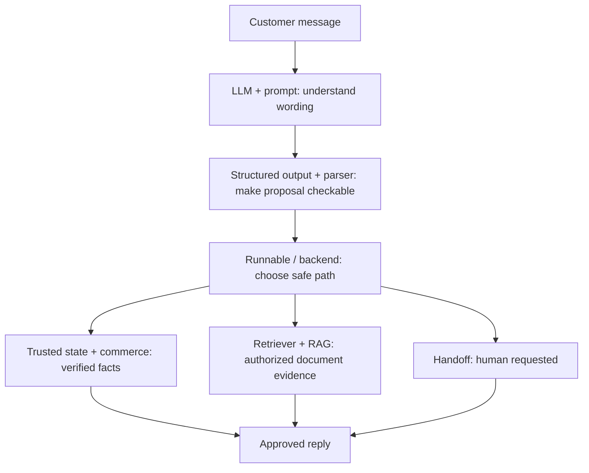

# Quick revision — the 12 concepts in one page

> **Use this sheet after the detailed lessons**, not as a substitute for them. These are personal study summaries, not copied lecture transcripts. All Chatout implementations described here are conceptual unless separately evidenced.

## One-minute mental model

| Concept | One-line definition | Mistake to avoid |
|---|---|---|
| LLM | Probabilistic language generator | Confidence ≠ fact |
| Chat model | Understands/generates conversational text | Not a DB |
| Prompt/messages | Structure roles, instructions and history | User text cannot grant authority |
| Structured output | Request an object with predictable fields | Valid shape ≠ allowed action |
| Output parser | Parse and validate model output | Valid JSON ≠ correct data |
| Runnable/chain | Compose known processing steps | Order and effects still need control |
| Document loader | Convert source files to text + metadata | Extracted ≠ approved |
| Text splitter | Cut text into useful evidence chunks | Dropping exceptions changes meaning |
| Embedding/vector store | Map text to vectors and search proximity | Nearest ≠ newest or true |
| Retriever | Select relevant permitted documents | top-k ≠ guaranteed relevance |
| RAG | Retrieve evidence for answer generation | Does not require fine-tuning |
| Agentic AI | Bounded step/tool selection using state | Autonomy ≠ safety or business permission |

## Three high-signal project questions

**Question 1 — checkout follow-up:** “Send the link” after three earlier turns: where is selected variant stored? **Answer:** in trusted conversation state. The model may propose intent; backend recovers and rechecks.

**Question 2 — mixed request:** “Link bhejo ya human se baat.” Why can a single enum fail? **Answer:** two independent signals can coexist; preserve the human flag and execute the configured handoff policy.

**Question 3 — merchant RAG:** W1 policy says 7 days, W2 says 14. How avoid data leakage? **Answer:** derive tenant identity from authenticated backend context, filter at retrieval, validate source/version, abstain without evidence.

## What to build first (lab only)

1. **Strict intent proposal + multi-turn state fixture** — tests real checkout/handoff failure modes.
2. **Two-tenant document ingest and retrieval** — tests metadata, revocation and isolation.
3. **Grounded RAG response with abstention** — tests source support rather than fluency.
4. **Optional bounded graph/agent comparison** — only if deterministic flow is insufficient.

**No production changes follow automatically from this order.** The Chatout Excel master tracker remains sole product plan, and launch/send gates remain intact.

## Five-minute self-check

1. Explain the difference between chat model and embedding model.
2. Why can schema validation pass a cross-tenant product ID?
3. Name a question where RAG should **not** be the source of truth.
4. Contrast sequential, parallel, and conditional chains.
5. Explain why agentic retries around a transaction require idempotency.

If any answer is unclear, return to the corresponding [class note](README.md). If all five are clear, describe the [Visual atlas](visual-atlas.md) without reading it.

**Next unfinished lesson:** LangChain vs LangGraph. Preview vocabulary is not counted as completed learning.
