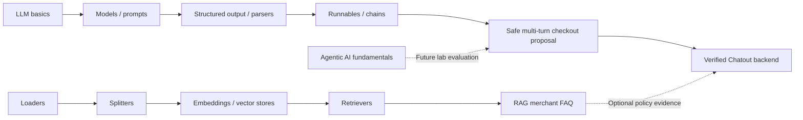
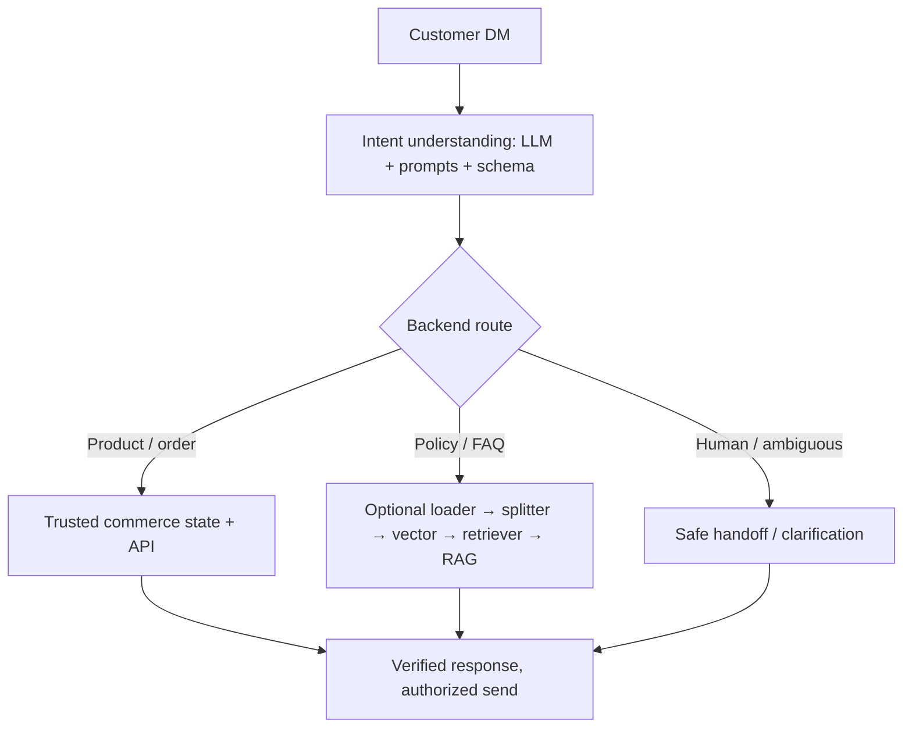

# Course-to-Chatout map — what we studied and why it matters

> This is a **learning-to-engineering bridge**, not a production backlog. Class numbers below are **internal topic order**; they are not claims about CampusX's official video numbering. Only previously discussed topics are included. The next topic, LangChain vs LangGraph, is **not marked complete**.

## Learning pathway at a glance

## Class-by-class application matrix

| Studied concept | When to use it | Chatout example | Failure to prevent | Lab proof required |
|---|---|---|---|---|
| [01 LLMs](langchain/01-introduction-llms.md) | Understand a natural-language request | “2 ski wax bhej do” | Fluent but fabricated business claims | Clear intent without effects |
| [02 Components/models](langchain/02-components-and-models.md) | Separate model responsibilities | Chat model vs embedding model | Semantic similarity confused with stock | Interfaces can be mocked |
| [03 Prompts/messages](langchain/03-prompts-and-messages.md) | Supply role-aware context | Turn-4 checkout follow-up | Losing trusted prior product selection | Correct multi-turn fixture |
| [04 Structured outputs](langchain/04-structured-outputs.md) | Require a typed *proposal* | checkout + requested_human flag | Single-label mixed-intent loss | Strict schema plus semantic checks |
| [05 Output parsers](langchain/05-output-parsers.md) | Decode/validate output | Reject string “two” as invalid quantity | Malformed action requests | Zero effects on parse error |
| [06 Runnables/chains](langchain/06-runnables-and-chains.md) | Orchestrate fixed steps | classify → validate → route | Unsafe ordering and branch erasure | Deterministic route traces |
| [07 Loaders](langchain/07-document-loaders.md) | Ingest approved merchant documents | Return policy PDF | Missing tenant/source metadata | Extract and trace origin |
| [08 Splitters](langchain/08-text-splitters.md) | Preserve retrieval-sized context | Keep return exceptions with rule | Fragmented policy answer | Chunk coverage / citation test |
| [09 Embeddings/stores](langchain/09-embeddings-and-vector-stores.md) | Find semantically similar passages | Hindi return question → English policy | Cross-merchant contamination | Zero wrong-tenant search results |
| [10 Retrievers](langchain/10-retrievers.md) | Fetch approved evidence | Merchant product-care guidance | Outdated, irrelevant top-k hits | Recall@k + version filtering |
| [11 RAG](langchain/11-rag.md) | Ground document-based answers | “Return kitne din mein?” | Unsupported or wrong policy statement | Citation correctness, abstention |
| [Agentic AI basics](agentic-ai/01-what-is-agentic-ai.md) | Reason about bounded tool choices | Clarify vs read-only lookup | Unlimited retries, fake checkout | Step limit, tool allowlist, no effects |

## What would be used where?

**Architectural decision:** The first practical value is **robust multi-turn intent and handoff handling**. RAG is a separate optional **merchant knowledge** capability. Agent-style autonomy must earn its complexity through evaluation; a fixed workflow may be enough.

## Study each lesson with the same six questions

1. **What?** Explain concept in simple Hinglish without confusing jargon.
2. **Why?** Identify what problem the component actually solves.
3. **Where?** Point to the exact *proposed* Chatout boundary.
4. **Where not?** Identify what must stay in deterministic backend control.
5. **Prove it.** Describe synthetic input, expected output, a negative case, and a metric.
6. **Decide.** Use now as a principle, prototype in lab, or defer with reason.

### Example answer: Why not use RAG for stock?

A vector index can return a *similar paragraph* about stock, but it cannot guarantee the item's **current** quantity or checkout readiness. For live availability, the authorized backend must check the current Shopify record. Use RAG for approved merchant return/shipping/care documents, with strict workspace and version filters.

## Lectures and factual status

- **Source track:** CampusX “Generative AI using LangChain” — concepts from our completed/discussed class conversations.
- **Source track:** CampusX “Agentic AI using LangGraph” — **Video 2: What is Agentic AI?** discussed; quiz **1/1**, hands-on lab not completed.
- **Next:** LangChain vs LangGraph (following Agentic AI playlist video) is **pending**, even though some terminology appears as a preview in the notes.
- **Course evidence:** We did not perform a full transcript-by-transcript verification against the videos. These are independent explanatory notes based on **our discussions**, not reproductions of lecture transcripts.
- **Project evidence:** The notes never assert an experiment or Chatout integration passed without recorded output.

More visuals: [Visual atlas](visual-atlas.md). Progress evidence: [Learning tracker](learning-progress.md).
