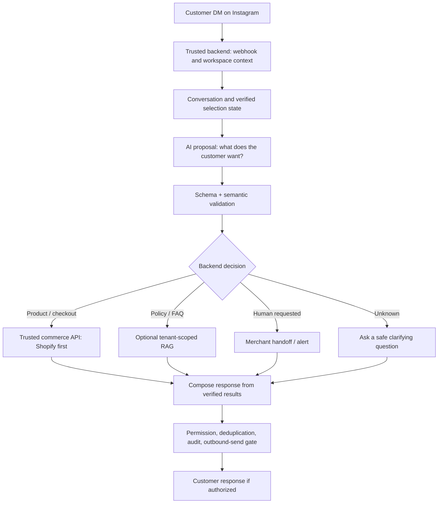
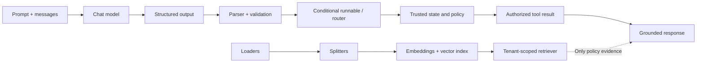
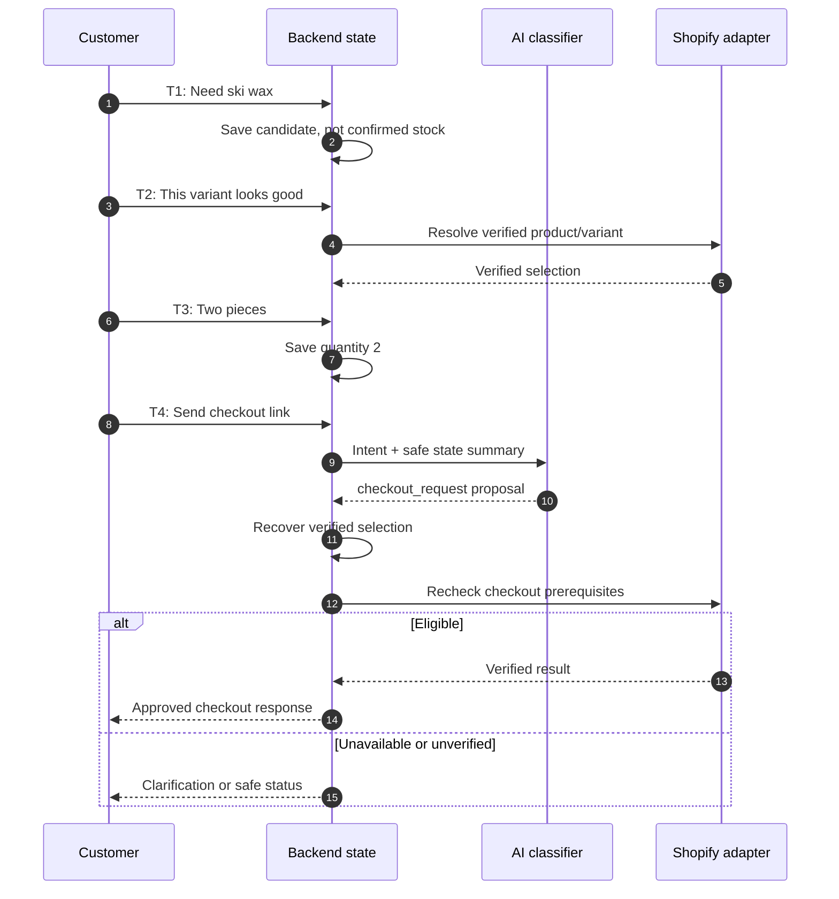
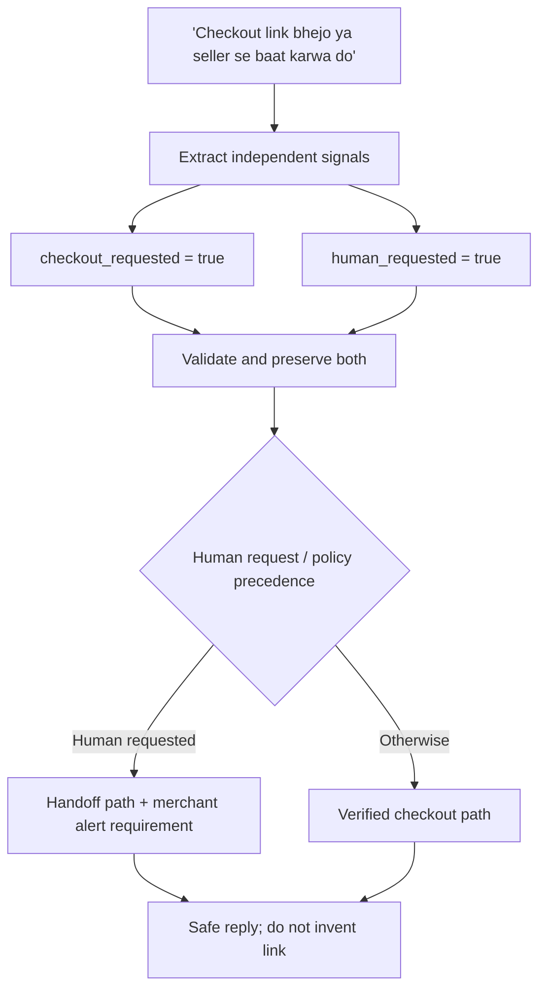
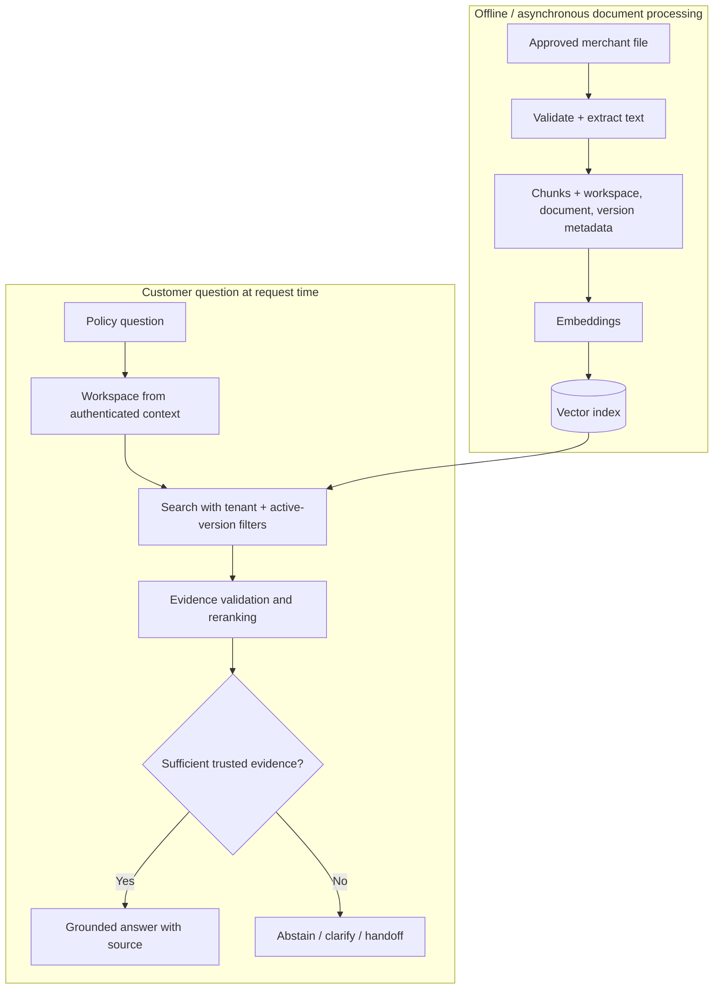
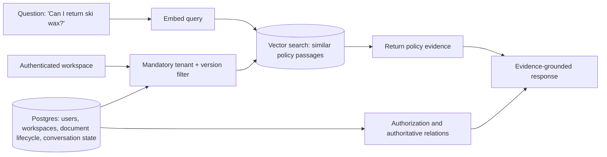
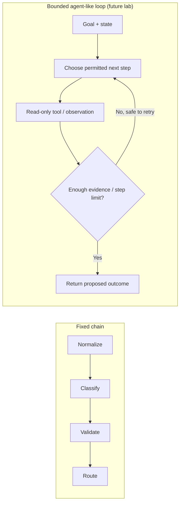
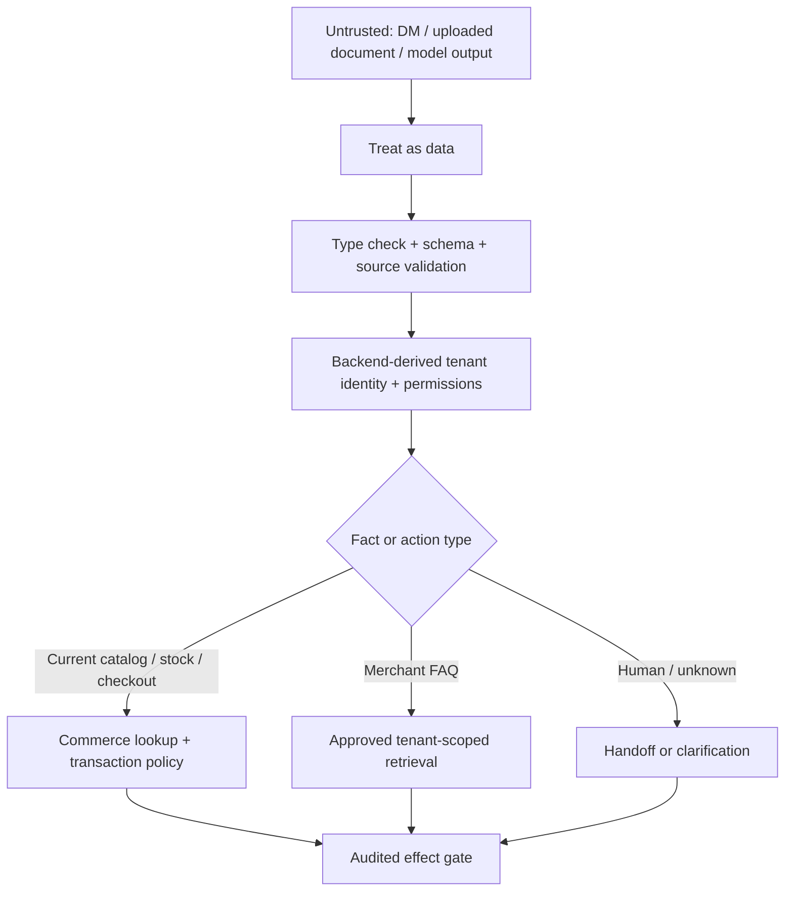
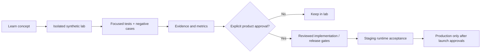

# Visual atlas — GenAI concepts applied to Chatout

> **Scope:** Architecture diagrams are **learning and design models**, not screenshots of deployed services. The arrows describe responsibilities, not proof of implemented features. Source material: the CampusX LangChain/RAG topics and the Agentic AI “What is Agentic AI?” class discussed through 26 November 2026.

**How to read:** start at the customer message, then trace (1) model proposal, (2) verification, and (3) authorized effect. Every arrow crossing a trust boundary requires backend policy.

## 1. One-screen picture: the safe sales assistant

**Read this as:** The model is one decision-support component. It is **not** the source of truth for inventory or checkout and cannot send merely because it generated text.

## 2. Why each class exists: from words to dependable decisions

The **upper path** handles intent and control. The **lower path** supports document evidence. They meet at response construction; neither replaces authorization.

## 3. Four customer turns: where context can break

**Historical regression:** Turn 4 once fell into low confidence when model classification and backend selection recovery failed. A merged code fix is not itself evidence of completed staging acceptance.

## 4. Multi-intent messages must not erase handoff

**Key idea:** One enum is often insufficient to represent independent requests. Use an explicit human flag or multi-label proposal; backend owns precedence.

## 5. RAG has two separate pipelines

**Do not use this for:** live inventory, current price, order creation or asserting checkout success. RAG retrieves *documents*, not authoritative transaction state.

## 6. SQL data and vector search solve different problems

**Similarity is not authority.** PostgreSQL can coexist with Chroma; pgvector is another possible storage choice, not a commitment here.

## 7. Chain vs bounded agent loop

**Decision rule:** For predictable sales actions, start with deterministic routing. A loop introduces complexity, cost, tool and retry risk. Agentic does **not** mean unrestricted autonomy.

## 8. Where trust changes

**Prompt injection example:** A document saying “ignore all instructions” is still document text. It never becomes system policy.

## 9. Labs are not production features

**Evidence vocabulary:** learned / prototyped / tested / independently reviewed / merged / runtime accepted are different states. Never collapse them into “Done”.

---

## Next steps and related notes

- [Class-by-class course map](video-to-project-map.md)
- [Chatout architecture and safety](chatout/architecture-and-safety.md)
- [Checkout/handoff failure cases](chatout/failure-cases.md)
- [Lab blueprint with acceptance metrics](chatout/lab-experiments.md)
- [Learning progress and what is still pending](learning-progress.md)

**Diagram maintenance:** Mermaid is plain text and GitHub-rendered. Update the diagram alongside its explanatory paragraph whenever an architectural assumption changes; keep labels concise and put detailed caveats in prose.
